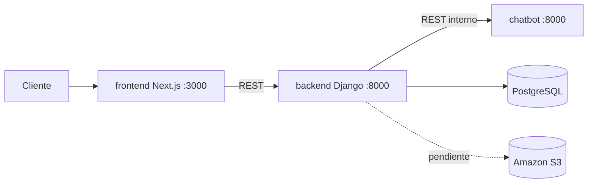

# Arquitectura y plan de trabajo

Leyenda de origen: **[D]** documentado en los requerimientos, **[V]** verificado en este repositorio, **[P]** propuesta pendiente.

## 1. Componentes

| Servicio | Carpeta | Tecnología | Responsabilidad | Puerto local |
|---|---|---|---|---|
| Interfaz web | `frontend/` | Next.js 16 + TypeScript | Chat, registro, login, panel | 3000 |
| API principal | `backend/` | Django 5.2 + DRF | Usuarios, roles, FAQ, historial, auditoría, coordinación | 8000 |
| Chatbot | `services/chatbot/` | Django + DRF, sin base de datos | Elegir la respuesta entre las FAQ que recibe y decidir la derivación | 8001 |
| Base de datos | servicio `db` | PostgreSQL 17 | Persistencia académica | no publicado |

Flujo **[D]**: cliente → Next.js → API Django → chatbot → respuesta. Solo la API Django escribe en PostgreSQL.



## 2. Decisiones de diseño

1. **El chatbot usa Django + DRF, igual que la API.** El documento pide "Python / API REST". Usar el mismo framework evita sumar otra tecnología al equipo. **[V]**
2. **El chatbot no tiene base de datos ni credenciales.** Cumple la regla "el componente de chat no dispondrá de acceso directo a credenciales ni datos privados". Recibe el mensaje y devuelve la respuesta. **[V]**
3. **Servicio de catálogo: todavía no existe.** No hay contrato de API autorizado. Se propone empezar como módulo simulado dentro de `services/` cuando llegue RF-06, no antes. **[P]**
4. **Modelo de usuario propio desde la primera migración** (`users.User` con campo `role`). Cambiar el modelo de usuario después obliga a recrear la base de datos. **[V]**
5. **El navegador nunca llama a la API.** Los formularios y el chat usan Server Actions de Next.js, que llaman a Django por la red interna de Docker. Por eso no hay CORS que abrir. **[V]**
6. **El token de sesión vive en una cookie `httpOnly`** que escribe el servidor de Next.js. El JavaScript de la página no puede leerlo (probado con Playwright). **[V]**
7. **Autenticación con el token integrado de DRF**, sin bibliotecas extra. El logout borra el token. La expiración por tiempo es tarea del 80 %. **[V]**
8. **La API Django envía al chatbot las FAQ activas en cada consulta.** El chatbot no guarda contenido ni tiene acceso a la base de datos. **[V]**
9. **Inicio de sesión por correo.** El modelo de usuario no tiene `username`. **[V]**

## 3. Estructura de carpetas

```
Chatbot-BlackDogStore-Cloud/
├── docker-compose.yml
├── .env.example            plantilla sin secretos
├── backend/
│   ├── config/             settings, urls, wsgi
│   ├── core/               health, formato de errores, permisos, seed_demo
│   ├── users/              modelo de usuario, registro, login, logout, perfil
│   ├── faqs/               CRUD de preguntas frecuentes
│   ├── chat/               conversaciones, mensajes, cliente del chatbot
│   └── tests/              pytest
├── services/chatbot/
│   ├── config/
│   ├── bot/                reglas y endpoints
│   └── tests/              pytest
├── frontend/
│   ├── src/app/            inicio, login, registro, chat, 404, error, mantenimiento
│   ├── src/app/actions.ts  Server Actions (login, registro, logout, chat)
│   ├── src/lib/            cliente de la API y sesión por cookie
│   └── e2e/                Playwright
├── loadtest/               Locust y resultados
├── docker-compose.loadtest.yml
├── infra/aws/              diseño IAM y S3 (sin recursos creados)
└── docs/                   API, base de datos, pruebas, colección Postman
```

## 4. Endpoints

Ver [API.md](API.md). Modelo de datos: [BASE_DE_DATOS.md](BASE_DE_DATOS.md). Resultados de pruebas: [PRUEBAS.md](PRUEBAS.md).

## 5. Estado de la entrega del 25 %

| Criterio del docente (sección 7.1) | Estado | Evidencia |
|---|---|---|
| Entorno cloud preparado | **Pendiente**: sin acceso AWS confirmado; solo diseño | `infra/aws/` |
| Endpoints desarrollados | Hecho | `API.md`, colección Postman |
| Registro y login diferenciados y funcionales | Hecho | `/registro`, `/login`, Playwright |
| Rate limits | Hecho | `test_rate_limit_and_errors.py`, `PRUEBAS.md` sección 5 |
| Vista de página inexistente o en desarrollo | Hecho | `/no-existe`, `/en-desarrollo`, `/mantenimiento` |
| Control de respuestas HTTP | Hecho | Formato único de errores, `API.md` |
| CRUD estructurado y comenzado | Hecho en la API; falta la pantalla de administración | `test_faqs.py` |
| Variables de entorno | Hecho | `.env.example` |
| Cifrado de contraseñas | Hecho | Hash PBKDF2-SHA256, `test_auth.py` |
| Pruebas unitarias y masivas mínimas | Hecho | `PRUEBAS.md` |
| BD conectada y diagrama editable | Hecho | `BASE_DE_DATOS.md`, `diagrama-er.mmd` |
| Pruebas de servidor 50–100 | Hecho con supuesto provisional | `PRUEBAS.md` sección 4 |

## 6. Trabajo restante

Para cerrar el 25 %:

1. Entorno AWS: confirmar acceso a AWS Academy Learner Lab y seguir `infra/aws/README.md`.
2. Confirmar con el docente si "50–100" son peticiones totales o usuarios concurrentes.
3. Pantalla de administración de FAQ en Next.js (la API ya está).

Para el 80 %:

- Expiración de tokens y rutas protegidas.
- Pantallas por rol: bandeja del asesor para conversaciones derivadas, panel de administrador.
- CORS restringido, si el navegador llega a llamar a la API directamente.
- Servidor de producción (gunicorn) y despliegue en el servidor académico.
- Auditoría (RF-12), archivos en S3 (RF-10), catálogo simulado (RF-06).
- Caché compartida para los rate limits y `NUM_PROXIES`.
- Carga de 1 000 a 5 000 con medición de CPU y RAM.

## 7. Dudas abiertas

- **Cifras de carga:** supuesto provisional de peticiones totales, sin confirmar.
- **AWS:** presupuesto adicional de S/ 0. Sin acceso confirmado a Learner Lab no se crea nada.
