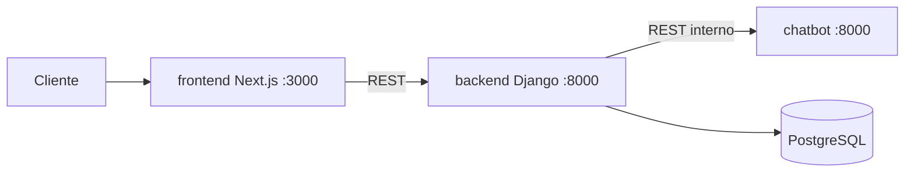

# Arquitectura y plan de trabajo

Leyenda de origen: **[D]** documentado en los requerimientos, **[V]** verificado en este repositorio, **[P]** propuesta pendiente.

## 1. Componentes

| Servicio | Carpeta | Tecnología | Responsabilidad | Puerto local |
|---|---|---|---|---|
| Interfaz web | `frontend/` | Next.js 16 + TypeScript | Chat, registro, login, panel | 3000 |
| API principal | `backend/` | Django 5.2 + DRF, gunicorn | Usuarios, roles, FAQ, historial, auditoría, CORS, coordinación | 8000 |
| Chatbot | `services/chatbot/` | Django + DRF con gunicorn, sin base de datos | Elegir la respuesta entre las FAQ que recibe y decidir la derivación | 8001 |
| Base de datos | servicio `db` | PostgreSQL 17 | Persistencia académica | no publicado |

Flujo **[D]**: cliente → Next.js → API Django → chatbot → respuesta. Solo la API Django escribe en PostgreSQL.



## 2. Decisiones de diseño

1. **El chatbot usa Django + DRF, igual que la API.** El documento pide "Python / API REST". Usar el mismo framework evita sumar otra tecnología al equipo. **[V]**
2. **El chatbot no tiene base de datos ni credenciales.** Cumple la regla "el componente de chat no dispondrá de acceso directo a credenciales ni datos privados". Recibe el mensaje y devuelve la respuesta. **[V]**
3. **Servicio de catálogo: todavía no existe.** No hay contrato de API autorizado. Se propone empezar como módulo simulado dentro de `services/` cuando llegue RF-06, no antes. **[P]**
4. **Modelo de usuario propio desde la primera migración** (`users.User` con campo `role`). Cambiar el modelo de usuario después obliga a recrear la base de datos. **[V]**
5. **El navegador nunca llama a la API.** Los formularios y el chat usan Server Actions de Next.js, que llaman a Django por la red interna de Docker. Por eso no hay CORS que abrir. **[V]**
6. **El token de sesión vive en una cookie `httpOnly`** que escribe el servidor de Next.js. El JavaScript de la página no puede leerlo (probado con Playwright). **[V]**
7. **Autenticación con el token integrado de DRF**, sin bibliotecas extra, con caducidad absoluta de 8 h (`users/authentication.py`). El logout borra el token. **[V]**
8. **La API Django envía al chatbot las FAQ activas en cada consulta.** El chatbot no guarda contenido ni tiene acceso a la base de datos. **[V]**
9. **Inicio de sesión por correo.** El modelo de usuario no tiene `username`. **[V]**
10. **gunicorn en lugar de `runserver`.** `runserver` reiniciaba conexiones con 50 usuarios concurrentes (cola de 5). Los contadores de rate limit pasan a una caché compartida en PostgreSQL para que valgan entre procesos. **[V]**
11. **CORS con lista explícita y rechazo de orígenes desconocidos** (`core/middleware.py`, sin dependencias nuevas). Hoy el navegador no llama a la API, pero si un sitio ajeno lo intenta, recibe 403. **[V]**
12. **Auditoría en una app propia** (`audit`): registro inmutable de accesos, intentos fallidos, accesos denegados y operaciones del administrador y del asesor. Nunca guarda contraseñas, tokens ni contenido de mensajes, y un fallo al auditar no interrumpe la petición. **[V]**
13. **Conexiones persistentes a PostgreSQL** (`CONN_MAX_AGE=60`). Es la optimización con mayor efecto medido: la mediana de lectura con 100 usuarios bajó de 1000 a 48 ms. **[V]**
14. **Docker Compose con `restart: unless-stopped` y `healthcheck`** en los cuatro servicios; el frontend espera a que el backend esté `healthy`. **[V]**

## 3. Estructura de carpetas

```
Chatbot-BlackDogStore-Cloud/
├── docker-compose.yml
├── .env.example            plantilla sin secretos
├── backend/
│   ├── config/             settings, urls, wsgi
│   ├── core/               health, formato de errores, permisos, seed_demo
│   ├── users/              modelo de usuario, registro, login, logout, perfil
│   ├── faqs/               CRUD de preguntas frecuentes
│   ├── chat/               conversaciones, mensajes, cliente del chatbot
│   ├── audit/              registro de auditoría (RF-12), solo lectura para admin
│   └── tests/              pytest
├── services/chatbot/
│   ├── config/
│   ├── bot/                reglas y endpoints
│   └── tests/              pytest
├── frontend/
│   ├── src/app/            inicio, login, registro, chat, admin/faqs, admin/auditoria, asesor, 404, error, mantenimiento
│   ├── src/app/actions.ts  Server Actions (login, registro, logout, chat)
│   ├── src/lib/            cliente de la API y sesión por cookie
│   └── e2e/                Playwright
├── loadtest/               Locust y resultados
├── docker-compose.loadtest.yml
├── infra/render/           arranque de backend + chatbot en Render Free
├── infra/backup/           respaldo y prueba de restauración de PostgreSQL
├── infra/pruebas/          pruebas locales de caídas (resiliencia.sh)
├── infra/aws/              diseño IAM y S3 de la entrega del 25 % (sin recursos creados)
└── docs/                   API, base de datos, pruebas, colección Postman
```

## 4. Endpoints

Ver [API.md](API.md). Modelo de datos: [BASE_DE_DATOS.md](BASE_DE_DATOS.md). Resultados de pruebas: [PRUEBAS.md](PRUEBAS.md). Despliegue: [DESPLIEGUE.md](DESPLIEGUE.md). Respaldos: [BACKUPS.md](BACKUPS.md). Auditoría inicial del 80 %: [AUDITORIA_80.md](AUDITORIA_80.md).

## 5. Estado de la entrega del 25 %

| Criterio del docente (sección 7.1) | Estado | Evidencia |
|---|---|---|
| Entorno cloud preparado | Hecho por el equipo con Google Cloud, Render (backend y chatbot) y Neon (PostgreSQL) | `Dockerfile.render`, `infra/render/`, `POSTGRES_SSLMODE` en `backend/config/settings.py` |
| Endpoints desarrollados | Hecho | `API.md`, colección Postman |
| Registro y login diferenciados y funcionales | Hecho | `/registro`, `/login`, Playwright |
| Rate limits | Hecho | `test_rate_limit_and_errors.py`, `PRUEBAS.md` sección 5 |
| Vista de página inexistente o en desarrollo | Hecho | `/no-existe`, `/en-desarrollo`, `/mantenimiento` |
| Control de respuestas HTTP | Hecho | Formato único de errores, `API.md` |
| CRUD estructurado y comenzado | Hecho: API y pantalla `/admin/faqs` (crear, editar, activar/desactivar, eliminar) | `test_faqs.py`, Playwright |
| Variables de entorno | Hecho | `.env.example` |
| Cifrado de contraseñas | Hecho | Hash PBKDF2-SHA256, `test_auth.py` |
| Pruebas unitarias y masivas mínimas | Hecho | `PRUEBAS.md` |
| BD conectada y diagrama editable | Hecho | `BASE_DE_DATOS.md`, `diagrama-er.mmd` |
| Pruebas de servidor 50–100 | Hecho en las dos lecturas: 100 peticiones totales y 50/100 usuarios concurrentes, 0 fallos | `PRUEBAS.md` sección 4 |

## 6. Estado de la entrega del 80 %

| # | Criterio del docente | Estado | Evidencia |
|---|---|---|---|
| 01 | CRUD completo y funcional | Implementado y verificado | FAQ: API y `/admin/faqs`; `test_faqs.py`, Playwright, Newman |
| 02 | Paginación con tiempos cómodos | Implementado y verificado | `page_size` ≤ 100, `ordering`, `search`, índices; `test_pagination_and_queries.py`; `PRUEBAS.md` §10 |
| 03 | Múltiples tipos de usuario | Implementado y verificado | Cliente, asesor y administrador; accesos denegados en pytest y Playwright |
| 04 | Proyecto en el servidor | **Parcial** | Backend y chatbot en Render, base en Neon (equipo). Frontend: plan listo, falta publicarlo con autorización (`DESPLIEGUE.md`) |
| 05 | BD completa y diagrama | Implementado y verificado | `diagrama-er.mmd`, `diagrama-er.svg`, `BASE_DE_DATOS.md` |
| 06 | CORS | Implementado y verificado | `core/middleware.py`, `test_cors.py`, Newman |
| 07 | Pruebas contra caídas | Implementado y verificado (local) | `infra/pruebas/resiliencia.sh`, `PRUEBAS.md` §11 |
| 08 | Autenticación y autorización | Implementado y verificado | `test_auth.py`, `test_audit.py`, `test_advisor.py` |
| 09 | Ingreso con correo | Implementado y verificado | Login por correo, sin distinguir mayúsculas y sin espacios; mismo 401 para correo o contraseña erróneos |
| 10 | Tokens expirados y rutas protegidas | Implementado y verificado | `test_token_expiration.py`, token revocado, Playwright con rutas escritas a mano |
| 11 | Pantallas de errores y caídas | Implementado y verificado | 404, en desarrollo, mantenimiento, error, `global-error`, servicio no disponible, tiempo agotado, chatbot caído, sesión expirada, acceso restringido |
| 12 | Pruebas de 1000 a 5000 | Implementado y verificado **en local**; en el servidor, pendiente de autorización | `PRUEBAS.md` §10, `loadtest/resultados/` |
| 13 | Control de backups | Implementado y verificado (local) | `BACKUPS.md`, `infra/backup/` |
| Extra | VPC | Evaluado, no implementado | `DESPLIEGUE.md` §5 |
| Extra | Recursos del equipo | Medido | `GUNICORN_WORKERS=8`: +39 % y +85 % req/s (`PRUEBAS.md` §10) |

## 7. Trabajo restante

1. Publicar el frontend en Render y ajustar `CORS_ALLOWED_ORIGINS`, `NUM_PROXIES` y `DJANGO_HTTPS` en el backend (`DESPLIEGUE.md` §2).
2. Ejecutar la prueba de carga autorizada contra Render (`DESPLIEGUE.md` §4).
3. Generar un respaldo de Neon antes de la entrega (`BACKUPS.md`).

Para el 100 %: carga de 10 000 a 50 000, logs estructurados, gestión de incidencias y archivos adjuntos (RF-10).

## 8. Dudas abiertas

- **Cifras de carga:** se midieron las dos lecturas (solicitudes totales y usuarios concurrentes); conviene igualmente que el docente indique cuál evalúa.
