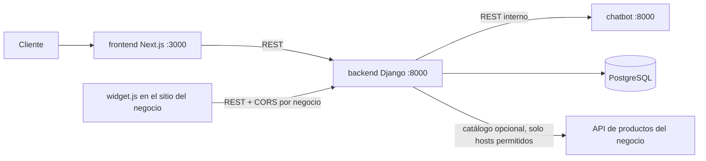

# Arquitectura y plan de trabajo

Leyenda de origen: **[D]** documentado en los requerimientos, **[V]** verificado en este repositorio, **[P]** propuesta pendiente.

## 1. Componentes

| Servicio | Carpeta | Tecnología | Responsabilidad | Puerto local |
|---|---|---|---|---|
| Interfaz web | `frontend/` | Next.js 16 + TypeScript | Chat, registro, login, panel | 3000 |
| API principal | `backend/` | Django 5.2 + DRF, gunicorn | Usuarios, roles, FAQ, historial, auditoría, CORS, coordinación | 8000 |
| Chatbot | `services/chatbot/` | Django + DRF con gunicorn, sin base de datos | Elegir la respuesta entre las FAQ que recibe y decidir la derivación | 8001 |
| Base de datos | servicio `db` | PostgreSQL 17 (Neon 18.6 en producción) | Persistencia académica | no publicado |
| Widget flotante | `backend/widget/static_src/widget.js` | JavaScript sin dependencias, Shadow DOM | Chat instalable en cualquier sitio con una etiqueta `<script>` | servido por el backend en `/widget.js` |

### Plataforma multiempresa (entrega del 100 %) [V]

- Cada negocio (`tenants.Business`) tiene sus FAQ, conversaciones, equipo, dominios autorizados y
  configuración del asistente. Black Dog Store es el negocio piloto, no un caso especial del código.
- El servidor resuelve el negocio (`tenants.context.resolve`). La cabecera `X-Business-Id` solo elige
  entre los negocios del propio usuario; nunca autoriza.
- Roles por negocio (`Membership`): administrador y asesor. El superadministrador de la plataforma
  (`is_superuser`) ve todos los negocios y su auditoría (`/plataforma`).
- Un recurso de otro negocio responde igual que uno inexistente (404).

Flujo del widget: visitante → `widget.js` en el sitio del negocio → API Django (CORS solo para los
dominios autorizados de ese negocio) → chatbot → respuesta. El visitante usa una sesión anónima con
token propio (`X-Visitor-Token`), sin cookies de terceros.

Flujo **[D]**: cliente → Next.js → API Django → chatbot → respuesta. Solo la API Django escribe en PostgreSQL.



## 2. Decisiones de diseño

1. **El chatbot usa Django + DRF, igual que la API.** El documento pide "Python / API REST". Usar el mismo framework evita sumar otra tecnología al equipo. **[V]**
2. **El chatbot no tiene base de datos ni credenciales.** Cumple la regla "el componente de chat no dispondrá de acceso directo a credenciales ni datos privados". Recibe el mensaje y devuelve la respuesta. **[V]**
3. **Conector de catálogo por negocio** (`chat/catalog.py`). Solo se consulta cuando ninguna FAQ responde. Lee la API de productos que el negocio configura (`catalog_api_url`), solo de hosts en `CATALOG_ALLOWED_HOSTS`, sin seguir redirecciones, con 2,5 s de límite y 1 MB como máximo. Si falla, la consulta pasa a un asesor. El bot nunca inventa precios ni stock: los copia del catálogo (RF-06). **[V]**
4. **Modelo de usuario propio desde la primera migración** (`users.User` con campo `role`). Cambiar el modelo de usuario después obliga a recrear la base de datos. **[V]**
5. **La interfaz web no llama a la API desde el navegador.** Los formularios y el chat usan Server Actions de Next.js, que llaman a Django por la red interna. La única excepción es el widget (entrega del 100 %): llama a `/api/widget/…` desde el navegador del visitante, con CORS limitado a los dominios que cada negocio autoriza. **[V]**
6. **El token de sesión vive en una cookie `httpOnly`** que escribe el servidor de Next.js. El JavaScript de la página no puede leerlo (probado con Playwright). **[V]**
7. **Autenticación con el token integrado de DRF**, sin bibliotecas extra, con caducidad absoluta de 8 h (`users/authentication.py`). El logout borra el token. **[V]**
8. **La API Django envía al chatbot las FAQ activas en cada consulta.** El chatbot no guarda contenido ni tiene acceso a la base de datos. **[V]**
9. **Inicio de sesión por correo.** El modelo de usuario no tiene `username`. **[V]**
10. **gunicorn en lugar de `runserver`.** `runserver` reiniciaba conexiones con 50 usuarios concurrentes (cola de 5). Los contadores de rate limit pasan a una caché compartida en PostgreSQL para que valgan entre procesos. **[V]**
11. **CORS con lista explícita y rechazo de orígenes desconocidos** (`core/middleware.py`, sin dependencias nuevas). Hoy el navegador no llama a la API, pero si un sitio ajeno lo intenta, recibe 403. **[V]**
12. **Auditoría en una app propia** (`audit`): registro inmutable de accesos, intentos fallidos, accesos denegados y operaciones del administrador y del asesor. Nunca guarda contraseñas, tokens ni contenido de mensajes, y un fallo al auditar no interrumpe la petición. **[V]**
13. **Conexiones persistentes a PostgreSQL** (`CONN_MAX_AGE=60`). Es la optimización con mayor efecto medido: la mediana de lectura con 100 usuarios bajó de 1000 a 48 ms. **[V]**
14. **Docker Compose con `restart: unless-stopped` y `healthcheck`** en los cuatro servicios; el frontend espera a que el backend esté `healthy`. **[V]**
15. **Rate limit con un contador atómico** (`core/throttling.py`): una consulta `UPSERT` por límite en lugar de 4. Bajó la mediana con 100 usuarios de 89-140 ms a 16-52 ms (`PRUEBAS.md` §12). **[V]**
16. **gunicorn con `--preload` y reciclaje escalonado** (`--max-requests 20000 --max-requests-jitter 4000`): evita pausas de ~45 s cuando varios procesos se reciclan a la vez. **[V]**
17. **Logs estructurados en JSON** (`core/logging.py`) con `timestamp`, `level`, `service`, `event` y `request_id`. Nunca registran contraseñas, tokens ni el contenido de los mensajes. **[V]**
18. **Migraciones compatibles con rollback** (expandir/contraer): `business_id` es anulable en la base y `asignar_negocio_piloto` asigna lo creado por una versión anterior (`MIGRACION_SERVIDOR.md`). **[V]**
19. **Código ofuscado para el navegador.** El backend sirve `widget/dist/widget.js`, generado con `javascript-obfuscator` desde el fuente legible `widget/static_src/widget.js`; el frontend se publica minificado y sin mapas de código fuente. La CI falla si el widget ofuscado no corresponde al fuente o si aparece un `.map` en `.next/static` (`PRUEBAS.md` §17). **[V]**

## 3. Estructura de carpetas

```
Chatbot-BlackDogStore-Cloud/
├── docker-compose.yml
├── .env.example            plantilla sin secretos
├── backend/
│   ├── config/             settings, urls, wsgi
│   ├── core/               health, formato de errores, permisos, seed_demo
│   ├── users/              modelo de usuario, registro, login, logout, perfil
│   ├── faqs/               CRUD de preguntas frecuentes
│   ├── chat/               conversaciones, mensajes, cliente del chatbot
│   ├── audit/              registro de auditoría (RF-12), solo lectura para admin
│   └── tests/              pytest
├── services/chatbot/
│   ├── config/
│   ├── bot/                reglas y endpoints
│   └── tests/              pytest
├── frontend/
│   ├── src/app/            inicio, login, registro, chat, admin/faqs, admin/auditoria, asesor, 404, error, mantenimiento
│   ├── src/app/actions.ts  Server Actions (login, registro, logout, chat)
│   ├── src/lib/            cliente de la API y sesión por cookie
│   └── e2e/                Playwright
├── loadtest/               Locust y resultados
├── docker-compose.loadtest.yml
├── infra/render/           arranque de backend + chatbot en Render Free
├── infra/backup/           respaldo y prueba de restauración de PostgreSQL
├── infra/pruebas/          pruebas locales de caídas (resiliencia.sh)
├── infra/aws/              diseño IAM y S3 de la entrega del 25 % (sin recursos creados)
└── docs/                   API, base de datos, pruebas, colección Postman
```

## 4. Endpoints

Ver [API.md](API.md). Modelo de datos: [BASE_DE_DATOS.md](BASE_DE_DATOS.md). Resultados de pruebas: [PRUEBAS.md](PRUEBAS.md). Despliegue: [DESPLIEGUE.md](DESPLIEGUE.md). Respaldos: [BACKUPS.md](BACKUPS.md). Auditoría inicial del 80 %: [AUDITORIA_80.md](AUDITORIA_80.md).

## 5. Estado de la entrega del 25 %

| Criterio del docente (sección 7.1) | Estado | Evidencia |
|---|---|---|
| Entorno cloud preparado | Hecho por el equipo con Google Cloud, Render (backend y chatbot) y Neon (PostgreSQL) | `Dockerfile.render`, `infra/render/`, `POSTGRES_SSLMODE` en `backend/config/settings.py` |
| Endpoints desarrollados | Hecho | `API.md`, colección Postman |
| Registro y login diferenciados y funcionales | Hecho | `/registro`, `/login`, Playwright |
| Rate limits | Hecho | `test_rate_limit_and_errors.py`, `PRUEBAS.md` sección 5 |
| Vista de página inexistente o en desarrollo | Hecho | `/no-existe`, `/en-desarrollo`, `/mantenimiento` |
| Control de respuestas HTTP | Hecho | Formato único de errores, `API.md` |
| CRUD estructurado y comenzado | Hecho: API y pantalla `/admin/faqs` (crear, editar, activar/desactivar, eliminar) | `test_faqs.py`, Playwright |
| Variables de entorno | Hecho | `.env.example` |
| Cifrado de contraseñas | Hecho | Hash PBKDF2-SHA256, `test_auth.py` |
| Pruebas unitarias y masivas mínimas | Hecho | `PRUEBAS.md` |
| BD conectada y diagrama editable | Hecho | `BASE_DE_DATOS.md`, `diagrama-er.mmd` |
| Pruebas de servidor 50–100 | Hecho en las dos lecturas: 100 peticiones totales y 50/100 usuarios concurrentes, 0 fallos | `PRUEBAS.md` sección 4 |

## 6. Estado de la entrega del 80 %

| # | Criterio del docente | Estado | Evidencia |
|---|---|---|---|
| 01 | CRUD completo y funcional | Implementado y verificado | FAQ: API y `/admin/faqs`; `test_faqs.py`, Playwright, Newman |
| 02 | Paginación con tiempos cómodos | Implementado y verificado | `page_size` ≤ 100, `ordering`, `search`, índices; `test_pagination_and_queries.py`; `PRUEBAS.md` §10 |
| 03 | Múltiples tipos de usuario | Implementado y verificado | Cliente, asesor y administrador; accesos denegados en pytest y Playwright |
| 04 | Proyecto en el servidor | **Parcial** | Backend y chatbot en Render, base en Neon (equipo). Frontend: plan listo, falta publicarlo con autorización (`DESPLIEGUE.md`) |
| 05 | BD completa y diagrama | Implementado y verificado | `diagrama-er.mmd`, `diagrama-er.svg`, `BASE_DE_DATOS.md` |
| 06 | CORS | Implementado y verificado | `core/middleware.py`, `test_cors.py`, Newman |
| 07 | Pruebas contra caídas | Implementado y verificado (local) | `infra/pruebas/resiliencia.sh`, `PRUEBAS.md` §11 |
| 08 | Autenticación y autorización | Implementado y verificado | `test_auth.py`, `test_audit.py`, `test_advisor.py` |
| 09 | Ingreso con correo | Implementado y verificado | Login por correo, sin distinguir mayúsculas y sin espacios; mismo 401 para correo o contraseña erróneos |
| 10 | Tokens expirados y rutas protegidas | Implementado y verificado | `test_token_expiration.py`, token revocado, Playwright con rutas escritas a mano |
| 11 | Pantallas de errores y caídas | Implementado y verificado | 404, en desarrollo, mantenimiento, error, `global-error`, servicio no disponible, tiempo agotado, chatbot caído, sesión expirada, acceso restringido |
| 12 | Pruebas de 1000 a 5000 | Implementado y verificado **en local**; en el servidor, pendiente de autorización | `PRUEBAS.md` §10, `loadtest/resultados/` |
| 13 | Control de backups | Implementado y verificado (local) | `BACKUPS.md`, `infra/backup/` |
| Extra | VPC | Evaluado, no implementado | `DESPLIEGUE.md` §5 |
| Extra | Recursos del equipo | Medido | `GUNICORN_WORKERS=8`: +39 % y +85 % req/s (`PRUEBAS.md` §10) |

## 7. Estado de la entrega del 100 %

Detalle requisito por requisito, con la evidencia y la distinción entre local y Render: `INFORME_ENTREGA_100.md`.

| Criterio del docente | Estado | Evidencia |
|---|---|---|
| Proyecto funcional al 100 % | Implementado y verificado en Render | Plataforma multiempresa, widget en la tienda demo, 22 FAQ reales, catálogo (`PRUEBAS.md` §14) |
| Pruebas de 10 000 a 50 000 | Verificado **en local**; en Render, prueba controlada hasta 5 000 (0 fallos) | `PRUEBAS.md` §12 y §16, `loadtest/resultados/`, gráficos en `evidencias/` |
| Controlar los cuellos de botella | Implementado y verificado | Contador atómico, `--preload`, perfil de carga corregido (`PRUEBAS.md` §12.6) |
| Logs estructurados | Implementado y verificado (local) | `core/logging.py`, decisión 17 |
| Errores esperados y caídas | Implementado y verificado | `PRUEBAS.md` §13 (7 escenarios, 0 fallas) y §15 (incidencias) |
| Extra: CI/CD | Implementado y verificado | `.github/workflows/ci.yml` + SonarCloud; Render despliega `main` |
| Extra: migración de servidor | Documentado | `MIGRACION_SERVIDOR.md` |

Las entregas anteriores siguen vigentes, con dos cambios: el frontend ya está publicado en Render (criterio
04 del 80 %) y el respaldo de Neon se hizo el 10 de noviembre (`neon_20261110-171155.dump`).

## 8. Trabajo restante

1. En Render, el límite anónimo de 60/min no se aplicó a peticiones directas (`PRUEBAS.md` §16.4).
   Revisar `THROTTLE_ANON` y `NUM_PROXIES` en el servicio del backend; el código está verificado en local.
2. Carga de 10 000 a 50 000 contra Render: no autorizada, para no agotar Render Free ni la cuota de Neon.
   Contra Render se hizo una prueba controlada de hasta 5 000 solicitudes (`PRUEBAS.md` §16).
3. RF-10, archivos adjuntos con Amazon S3: fuera del alcance evaluado; no implementado.

## 9. Dudas abiertas

- **Cifras de carga:** se midieron las dos lecturas (solicitudes totales y usuarios concurrentes); conviene igualmente que el docente indique cuál evalúa.
