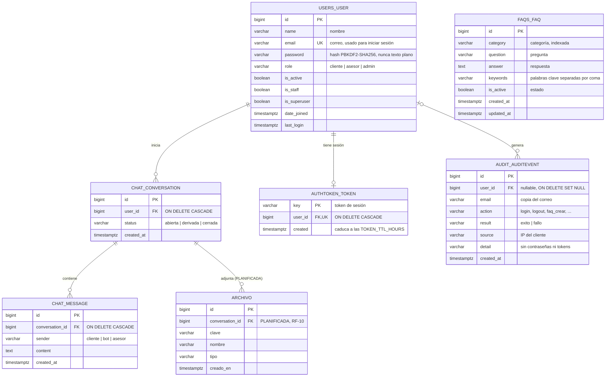

# Base de datos

PostgreSQL 17. Solo la API Django lee y escribe. Solo contiene datos ficticios.

Fuente editable del diagrama: [`diagrama-er.mmd`](diagrama-er.mmd) (Mermaid). Versión visual: [`diagrama-er.svg`](diagrama-er.svg). Si se cambia la fuente, copiar el contenido al bloque de abajo y regenerar la imagen:

```bash
docker run --rm -u "$(id -u):$(id -g)" -v "$PWD/docs:/data" minlag/mermaid-cli:11.4.2 \
  -i diagrama-er.mmd -o diagrama-er.svg -b white
```



## Tablas implementadas

| Tabla | App Django | Requisito | Notas |
|---|---|---|---|
| `users_user` | `users` | RF-01, RF-02, RF-08 | Correo único. El rol por defecto es `cliente`. |
| `authtoken_token` | DRF | RF-02 | Un token por usuario. Se borra al cerrar sesión. |
| `faqs_faq` | `faqs` | RF-04, RF-07 | `is_active=false` oculta la FAQ al público y al chatbot. |
| `chat_conversation` | `chat` | RF-05, RF-09 | Pasa a `derivada` cuando el chatbot no encuentra respuesta. |
| `chat_message` | `chat` | RF-05 | Se borra en cascada con su conversación. |
| `audit_auditevent` | `audit` | RF-12 | Registro inmutable (sin edición ni borrado por la API). Si se borra el usuario, el evento queda con `user_id` nulo y conserva el correo. |
| `django_cache` | `core` | Rate limit | Contadores compartidos entre procesos de gunicorn. |

Django crea además sus tablas internas (`django_*`, `auth_group`, `auth_permission`).

## Integridad referencial

| Relación | Regla | Motivo |
|---|---|---|
| `chat_conversation.user_id → users_user.id` | `ON DELETE CASCADE` | El historial pertenece al usuario |
| `chat_message.conversation_id → chat_conversation.id` | `ON DELETE CASCADE` | Un mensaje no existe sin su conversación |
| `authtoken_token.user_id → users_user.id` | `ON DELETE CASCADE`, único | Un token por usuario |
| `audit_auditevent.user_id → users_user.id` | `ON DELETE SET NULL` | La auditoría debe sobrevivir al usuario |

Restricciones: `users_user.email` es único; `status`, `sender`, `role`, `action` y `result` solo aceptan los valores de sus `choices` (validados por la API).

## Índices

| Índice | Columnas | Consulta que acelera |
|---|---|---|
| `conv_estado_fecha_idx` | `status, created_at DESC, id DESC` | Bandeja del asesor: `WHERE status = … ORDER BY created_at DESC` |
| `conv_usuario_fecha_idx` | `user_id, created_at DESC, id DESC` | Historial propio y `latest` |
| `msg_conv_fecha_idx` | `conversation_id, created_at, id` | Mensajes de una conversación en orden |
| `audit_recientes_idx` | `created_at DESC, id DESC` | Listado de auditoría |
| `audit_accion_idx` | `action, created_at DESC` | Auditoría filtrada por acción |
| `faqs_faq_category_*` | `category` | Filtro por categoría |

Medición con `EXPLAIN ANALYZE` sobre 9056 conversaciones (bandeja, página 3), 29 de octubre de 2026:

| Plan | Tiempo |
|---|---|
| Sin índice: `Seq Scan` + `Sort` de 3184 filas | 2,18 ms |
| Con `conv_estado_fecha_idx`: `Index Scan`, sin ordenamiento | 1,08 ms |

Con el volumen actual la diferencia es pequeña. El recorrido completo crece con el número de conversaciones; el índice solo lee las filas de la página pedida. La mejora grande de rendimiento vino de reutilizar conexiones (ver `PRUEBAS.md`).

## Entidad planificada

- **Archivo** (RF-10): metadatos de archivos adjuntos. No se implementa en esta entrega porque requiere un almacenamiento externo de archivos y la regla del equipo es no agregar servicios que no sean imprescindibles.

## Diferencias con el modelo inicial del documento

- `FAQ` añade `keywords`: el chatbot por reglas necesita palabras clave para elegir la respuesta.
- Se añade `authtoken_token` para las sesiones.
- `EventoAuditoría` se implementa como `audit_auditevent`, con `email`, `source` y `detail` para poder revisar intentos fallidos sin guardar datos sensibles.

## Migraciones

```bash
docker compose run --rm -v "$PWD/backend:/app" backend python manage.py makemigrations
docker compose up -d --build backend     # aplica las migraciones al iniciar
```
