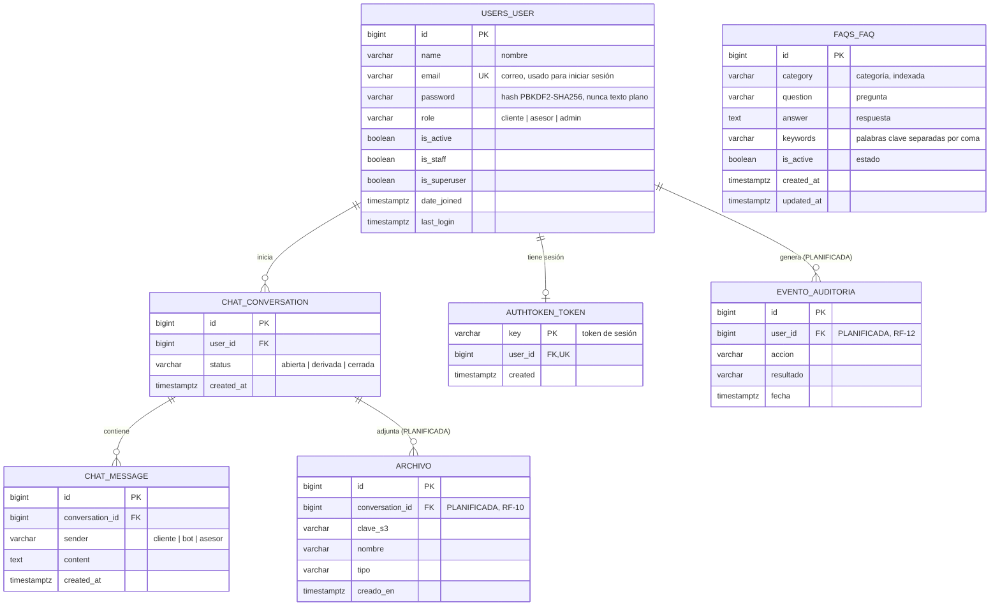

# Base de datos

PostgreSQL 17. Solo la API Django lee y escribe. Solo contiene datos ficticios.

Fuente editable del diagrama: [`diagrama-er.mmd`](diagrama-er.mmd) (Mermaid). Si se cambia ese archivo, copiar el contenido al bloque de abajo.



## Tablas implementadas

| Tabla | App Django | Requisito | Notas |
|---|---|---|---|
| `users_user` | `users` | RF-01, RF-02, RF-08 | Correo único. El rol por defecto es `cliente`. |
| `authtoken_token` | DRF | RF-02 | Un token por usuario. Se borra al cerrar sesión. |
| `faqs_faq` | `faqs` | RF-04, RF-07 | `is_active=false` oculta la FAQ al público y al chatbot. |
| `chat_conversation` | `chat` | RF-05, RF-09 | Pasa a `derivada` cuando el chatbot no encuentra respuesta. |
| `chat_message` | `chat` | RF-05 | Se borra en cascada con su conversación. |

Django crea además sus tablas internas (`django_*`, `auth_group`, `auth_permission`).

## Entidades planificadas

- **EventoAuditoría** (RF-12): accesos y operaciones relevantes.
- **Archivo** (RF-10): metadatos de archivos guardados en S3.

## Diferencias con el modelo inicial del documento

- `FAQ` añade `keywords`: el chatbot por reglas necesita palabras clave para elegir la respuesta.
- Se añade `authtoken_token` para las sesiones.

## Migraciones

```bash
docker compose run --rm -v "$PWD/backend:/app" backend python manage.py makemigrations
docker compose up -d --build backend     # aplica las migraciones al iniciar
```
