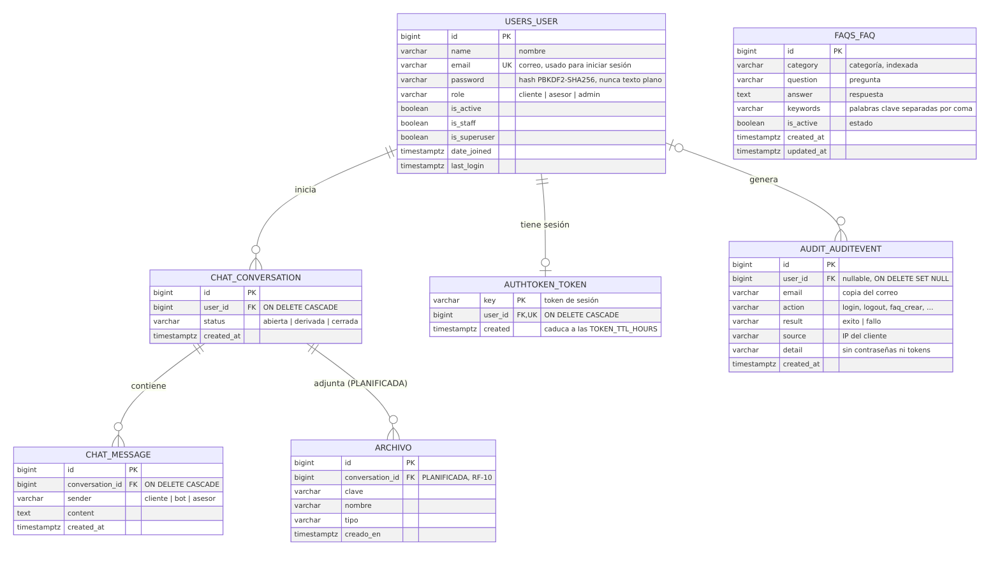
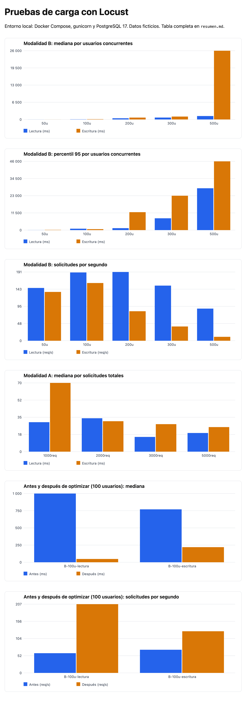

# TECSUP

**Curso:** Desarrollo de Soluciones en la Nube
**Docente:** CALVO GUZMÁN, VICTOR ALEJANDRO

## Informe técnico: entrega del 80 %

**Proyecto:** Chatbot Black Dog Store Cloud

**Integrantes:**

- Villar Collantes, Alexis
- Morales Puma, Gisela
- Kana Huillcapacco, Cesar
- Ochoa Chama, Briggith

**Fecha:** 29 de octubre de 2026

---

## Índice

1. Descripción y objetivo del proyecto
2. Arquitectura actual
3. Tecnologías utilizadas
4. Requisitos funcionales
5. Matriz de cumplimiento del 80 %
6. Desarrollo y evidencias por requisito
7. Incidencias encontradas y soluciones
8. Pendientes
9. Conclusiones

---

## 1. Descripción y objetivo del proyecto

El proyecto es un chatbot web de atención al cliente para Black Dog Store. Responde preguntas frecuentes sobre horarios, garantías y servicios técnicos, y deriva a un asesor las consultas que no puede resolver. Es un prototipo académico aislado de la tienda real: usa solo datos ficticios y no accede a sus sistemas.

**Objetivo de esta entrega:** completar y verificar los 13 requisitos del 80 % sobre lo construido en el 25 %. Esos requisitos cubren CRUD, paginación, roles, despliegue, base de datos, CORS, resiliencia, autenticación, tokens, pantallas de error, pruebas de carga y respaldos. Cada uno se acompaña de pruebas que se pueden repetir.

## 2. Arquitectura actual

```
Navegador ──HTTPS──> Next.js (frontend) ──REST──> API Django (backend) ──REST interno──> Chatbot (reglas y FAQ)
                                                      │
                                                      └──> PostgreSQL (local: Docker · nube: Neon)
```

| Servicio | Responsabilidad | Despliegue |
|---|---|---|
| Frontend Next.js | Interfaz bilingüe (es/en): registro, login, chat, administración de FAQ, bandeja del asesor, auditoría | Docker local; plan listo para Render Free |
| API Django + DRF | Usuarios, roles, tokens, FAQ, conversaciones, auditoría, CORS, rate limits | Docker local y Render Free |
| Chatbot | Elige la respuesta entre las FAQ activas que recibe; no tiene base de datos ni credenciales | Docker local; en Render, dentro de la instancia del backend, solo en `127.0.0.1` |
| PostgreSQL 17 | Persistencia; solo la API escribe | Docker local (puerto no publicado) y Neon con SSL |

Decisiones principales:

- El navegador nunca llama a la API directamente: lo hace el servidor de Next.js.
- El token de sesión vive en una cookie `httpOnly`.
- El chatbot no accede a datos privados.

Detalle completo en `docs/ARQUITECTURA.md`.

## 3. Tecnologías utilizadas

| Capa | Tecnología |
|---|---|
| Frontend | Next.js 16, React 19, TypeScript |
| Backend y chatbot | Python 3.12, Django 5.2, Django REST Framework 3.16, gunicorn |
| Base de datos | PostgreSQL 17 (local), Neon PostgreSQL (nube) |
| Contenedores | Docker, Docker Compose |
| Nube | Render Free (backend y chatbot), Neon Free (base de datos) |
| Pruebas | Pytest, Postman/Newman, Playwright, Locust |
| Control de versiones | Git y GitHub |

No se agregaron dependencias nuevas a la aplicación en esta entrega. CORS, auditoría, paginación y respaldos se resolvieron con Django, DRF y herramientas de PostgreSQL.

## 4. Requisitos funcionales

| ID | Requisito | Estado |
|---|---|---|
| RF-01 | Registro con validaciones | Implementado |
| RF-02 | Inicio y cierre de sesión seguros | Implementado |
| RF-03 | Interfaz de chat web | Implementado |
| RF-04 | FAQ por categoría administradas | Implementado |
| RF-05 | Historial según permisos | Implementado |
| RF-06 | Catálogo por API autorizada | Pendiente: no hay contrato de API; pantalla "en desarrollo" |
| RF-07 | Panel administrativo y CRUD de FAQ | Implementado |
| RF-08 | Roles cliente, asesor y administrador | Implementado |
| RF-09 | Derivación a asesor | Implementado |
| RF-10 | Archivos permitidos | Pendiente: requiere un almacenamiento externo no autorizado |
| RF-11 | Pantallas 404, en desarrollo y errores | Implementado |
| RF-12 | Auditoría de accesos y operaciones | **Implementado en esta entrega** |

## 5. Matriz de cumplimiento del 80 %

| # | Requisito | Estado | Evidencia principal |
|---|---|---|---|
| 01 | CRUD completo y funcional | Implementado y verificado | `test_faqs.py`, Playwright, Newman |
| 02 | Paginación y tiempos de respuesta | Implementado y verificado | `test_pagination_and_queries.py`, mediciones Locust |
| 03 | Múltiples tipos de usuario | Implementado y verificado | Pytest y Playwright de acceso permitido y denegado |
| 04 | Proyecto en el servidor | **Parcial** | Backend y chatbot en Render con Neon; frontend con plan listo (`DESPLIEGUE.md`) |
| 05 | Base de datos completa y diagrama | Implementado y verificado | `diagrama-er.mmd`, `diagrama-er.svg`, `BASE_DE_DATOS.md` |
| 06 | CORS seguro | Implementado y verificado | `test_cors.py`, Newman |
| 07 | Pruebas contra caídas | Implementado y verificado (local) | `infra/pruebas/resiliencia.sh` y su log |
| 08 | Autenticación y autorización | Implementado y verificado | `test_auth.py`, `test_audit.py`, `test_advisor.py` |
| 09 | Ingreso con correo | Implementado y verificado | `test_auth.py` |
| 10 | Tokens expirados y rutas protegidas | Implementado y verificado | `test_token_expiration.py`, Playwright |
| 11 | Pantallas de errores y caídas | Implementado y verificado | Playwright, `resiliencia.sh` |
| 12 | Pruebas de 1000 a 5000 (Locust) | Verificado en local; en el servidor, pendiente de autorización | `loadtest/resultados/` |
| 13 | Control de backups | Implementado y verificado (local) | `BACKUPS.md`, logs en `docs/evidencias/` |
| Extra | VPC | Evaluado; no aplicable con Render Free | `DESPLIEGUE.md` §5 |
| Extra | Recursos del equipo | Medido | 8 procesos de gunicorn: +39 % y +85 % de solicitudes por segundo |

**Resultado global de las pruebas (29 de octubre de 2026):**

| Suite | Resultado |
|---|---|
| Pytest backend | 144 de 144 |
| Pytest chatbot | 36 de 36 |
| Newman | 45 peticiones, 84 aserciones, 0 fallos |
| Playwright | 10 de 10 |
| ESLint, TypeScript, `next build` | Sin errores |
| `manage.py check --deploy` con `DJANGO_HTTPS=true` | Solo 2 avisos de HSTS (subdominios y precarga), descartados a propósito para un dominio compartido |
| Locust | 25 escenarios, 0 solicitudes fallidas |
| Resiliencia | 0 fallas en las verificaciones |

## 6. Desarrollo y evidencias por requisito

### 6.1 CRUD completo y funcional (01)

El recurso administrable es la **pregunta frecuente**:

- **Crear y editar:** con validación de campos; por ejemplo, se exige al menos una palabra clave.
- **Consultar:** listado paginado, detalle, búsqueda, filtro por categoría y orden configurable.
- **Activar y desactivar:** una FAQ inactiva desaparece para los clientes y para el chatbot, pero el administrador la sigue viendo.
- **Eliminar:** con confirmación en la interfaz.

Respuestas por caso:

| Caso | Respuesta |
|---|---|
| Cliente o asesor intenta escribir | 403 (queda registrado en la auditoría) |
| Sin sesión | 401 |
| Registro inexistente | 404 con mensaje genérico |
| Datos inválidos | 400 con `fields` |

No se crearon CRUD innecesarios:

- Conversaciones y mensajes se manejan con operaciones especializadas: enviar, responder y cerrar.
- La auditoría es de solo lectura (405 ante `POST`, `PATCH` o `DELETE`).

**Evidencia:**

- `backend/tests/test_faqs.py`.
- Playwright "el administrador crea, edita, desactiva y elimina una FAQ que usa el chatbot".
- Newman, carpeta 3.

### 6.2 Paginación y tiempos de respuesta (02)

- Todos los listados devuelven `count`, `next`, `previous` y `results`.
- `page_size` es configurable de 1 a 100 (por defecto 20). Un valor mayor se limita a 100.
- `ordering` permite ordenar FAQ y conversaciones, y `search` busca en las FAQ.
- Un estado desconocido responde 400 en lugar de un listado vacío.
- **Índices** justificados por consulta: bandeja por estado y fecha, historial por usuario y fecha, mensajes por conversación y fecha, y auditoría.
- **Sin N+1:** el nombre del cliente se carga con `select_related` y los mensajes con `prefetch_related`. Una prueba comprueba que el número de consultas no crece con las filas.

**Medición antes y después** (Locust, 100 usuarios, 60 s, 0 fallos):

| Escenario | Antes | Después |
|---|---|---|
| Lectura: mediana | 1000 ms | **48 ms** |
| Lectura: solicitudes por segundo | 59,5 | **207,4** |
| Escritura: mediana | 770 ms | **220 ms** |
| CPU media de PostgreSQL (lectura) | 152 % | 88 % |

La causa principal era abrir una conexión nueva a PostgreSQL en cada petición (`CONN_MAX_AGE=0`). Una prueba aislada, con todo lo demás igual y conexiones no persistentes, vuelve a 1200 ms. El índice de la bandeja reduce la consulta de 2,18 a 1,08 ms (`EXPLAIN ANALYZE`, 9056 conversaciones).

**Evidencia:**

- `backend/tests/test_pagination_and_queries.py`.
- `docs/PRUEBAS.md` §10.
- `docs/BASE_DE_DATOS.md`, sección Índices.

### 6.3 Múltiples tipos de usuario (03)

| Rol | Puede | No puede |
|---|---|---|
| Cliente | Registrarse, iniciar sesión, usar el chat, ver su historial, consultar FAQ activas | Ver conversaciones ajenas (404), escribir FAQ, abrir la bandeja ni la auditoría (403) |
| Asesor | Ver todas las conversaciones por estado, responder y cerrar | Administrar FAQ ni ver la auditoría |
| Administrador | Todo lo del asesor, CRUD de FAQ, FAQ inactivas y auditoría | Modificar o borrar la auditoría |

Los permisos se aplican en el backend (cada endpoint) y en el frontend (`RoleGate`). Un cliente que escribe a mano `/admin/auditoria`, `/admin/faqs` o `/asesor` ve "acceso restringido", también después de recargar la página.

**Evidencia:**

- `test_chat.py`: el cliente no lee ni continúa conversaciones ajenas.
- `test_advisor.py`.
- `test_audit.py`: solo el administrador lee la auditoría.
- Playwright: prueba de rutas escritas a mano.

### 6.4 Proyecto subido al servidor (04)

**Situación actual:**

- El equipo publicó el backend y el chatbot en un Web Service de **Render Free** (`Dockerfile.render`, `infra/render/start.py`).
- La base de datos está en **Neon** con `POSTGRES_SSLMODE=require`.
- El chatbot solo escucha en `127.0.0.1` dentro de la instancia.

**Cambios preparados en esta entrega (no desplegados todavía):**

- **Frontend:** Web Service de Render Free con `frontend/Dockerfile`, `API_INTERNAL_URL` y `COOKIE_SECURE=true`.
- **Backend:**
  - `CORS_ALLOWED_ORIGINS`.
  - `NUM_PROXIES`, para que el rate limit use la IP real del cliente.
  - `DJANGO_HTTPS=true`: cookies seguras, HSTS y redirección a HTTPS.
  - Conexiones persistentes hacia Neon.

El plan detalla los riesgos: la instancia que se duerme, la memoria de 512 MB y el valor de `NUM_PROXIES`.

**Evidencia:** `docs/DESPLIEGUE.md`.

### 6.5 Base de datos completa y diagrama (05)

Se agregó la entidad de auditoría del modelo inicial (`audit_auditevent`), con `ON DELETE SET NULL` para que el registro sobreviva al usuario. Las migraciones solo agregan una tabla e índices, sin pérdida de datos: los conteos se verificaron antes y después.



**Evidencia:**

- Fuente editable: `docs/diagrama-er.mmd` (Mermaid).
- Versiones visuales: `docs/diagrama-er.svg` y `docs/diagrama-er.png`.
- Integridad referencial e índices: `docs/BASE_DE_DATOS.md`.

### 6.6 CORS seguro (06)

`core/middleware.py` aplica una lista explícita de orígenes (`CORS_ALLOWED_ORIGINS`):

- Desarrollo: `http://localhost:3000`. Producción: la URL HTTPS del frontend.
- Con un comodín y `DEBUG=false`, la aplicación no arranca.

| Caso | Resultado probado |
|---|---|
| Origen permitido | 200 con `Access-Control-Allow-Origin` y `Vary: Origin` |
| Origen no permitido, incluido `null` | 403 `origin_not_allowed`, sin cabeceras CORS |
| Escritura desde un origen no permitido con token válido | 403 y nada se guarda |
| Preflight `OPTIONS` | 204 con los métodos y cabeceras autorizados, `Max-Age` 600 |
| Credenciales | No se envía `Allow-Credentials`: la API usa el encabezado `Authorization`, no cookies |
| Sin `Origin` (servidor de Next.js) | Sin cambios |

CORS es una política que aplican los navegadores y no reemplaza a la autenticación ni a los permisos. Por eso se probó que un origen permitido sin token sigue recibiendo 401.

**Evidencia:**

- `backend/tests/test_cors.py` (11 casos).
- Newman, carpeta 4c.

### 6.7 Pruebas para prevenir caídas (07)

`infra/pruebas/resiliencia.sh` simula fallas solo en Docker local:

- Usa `stop`, `pause` y `restart`.
- Nunca borra volúmenes.
- Cuenta los datos antes y después.

| Caso | Resultado |
|---|---|
| Chatbot detenido | Health 503; chat 503 `chatbot_unavailable`; no se guarda nada |
| Chatbot congelado | El backend corta a los 3 s y responde 503 |
| PostgreSQL detenido | 500 `server_error` genérico, sin detalles internos; el frontend muestra "Servicio no disponible" |
| PostgreSQL vuelve | Recuperación automática, sin reiniciar el backend |
| Backend detenido o congelado | Pantallas "Servicio no disponible" y "El servidor tardó demasiado" (8 s) |
| Termina el proceso del backend | Docker lo reinicia (`restart: unless-stopped`) |
| Reinicio completo con 20 usuarios | Corte breve: 5,1 % de solicitudes fallidas |
| Recarga en caliente (`HUP`) con 20 usuarios | **0 fallos** en 2453 solicitudes |

Para prevenir caídas se agregaron además:

- `healthcheck` en los cuatro servicios.
- gunicorn en el chatbot.
- `--max-requests` para reciclar procesos.
- Tiempos de espera en todas las llamadas internas.

**Evidencia:**

- `docs/evidencias/resiliencia_20261029-150817.log`.
- `docs/PRUEBAS.md` §11.

### 6.8 Autenticación y autorización (08)

Se conservó el mecanismo existente:

- Token de DRF con caducidad de 8 h.
- Cookie `httpOnly` en el navegador.
- Contraseñas con PBKDF2-SHA256 y validadores de Django.
- El rol en el registro se fuerza a `cliente`.

Respuestas:

- 401 cuando falta el token o no es válido.
- 403 cuando el rol no tiene permiso.

Se agregó la auditoría de:

- registros;
- inicios de sesión correctos y fallidos;
- cierres de sesión;
- tokens expirados;
- accesos denegados;
- operaciones sobre FAQ;
- respuestas y cierres del asesor.

La auditoría nunca guarda contraseñas ni tokens, y si falla no interrumpe la petición.

**Evidencia:** `test_auth.py`, `test_audit.py` (12 casos) y la pantalla `/admin/auditoria`, con filtros.

### 6.9 Ingreso mediante correo (09)

- El inicio de sesión es por correo y contraseña; el modelo no tiene `username`.
- El correo se normaliza: se ignoran mayúsculas y espacios.
- El registro rechaza un correo duplicado, también si cambian las mayúsculas.
- Correo inexistente y contraseña errónea reciben el mismo 401, para no revelar qué cuentas existen.
- El login tiene un límite de 10 intentos por minuto por IP.

**Evidencia:**

- `test_auth.py`: incluye `test_login_trims_spaces_and_ignores_case`.
- `test_rate_limit_and_errors.py`.
- Playwright "el registro rechaza un correo ya usado".

### 6.10 Tokens expirados y rutas protegidas (10)

| Caso | Resultado |
|---|---|
| Token válido | 200 |
| Token caducado | 401 `token_expired`; el token se borra y queda en la auditoría |
| Token inválido | 401 |
| Token revocado (después del logout) | 401 en todas las rutas |
| Ruta protegida sin sesión | El frontend redirige a `/login`, o a `/login?motivo=expirada` si la sesión caducó |
| Ruta administrativa con rol cliente | "Acceso restringido", también al recargar |

**Evidencia:**

- `test_token_expiration.py`.
- `test_revoked_token_cannot_be_reused`.
- Playwright.

### 6.11 Pantallas de errores y caídas (11)

| Situación | Pantalla |
|---|---|
| Página inexistente | 404 propia |
| Sección en desarrollo | `/en-desarrollo` |
| Mantenimiento | `/mantenimiento` |
| Error interno de una página | `error.tsx` con "Reintentar" |
| Falla del layout raíz | `global-error.tsx`, bilingüe |
| Backend no disponible | "Servicio no disponible" con "Reintentar" y enlace al estado de los servicios |
| Tiempo de espera agotado | "El servidor tardó demasiado" |
| Chatbot no disponible | Mensaje en el chat; el texto escrito se conserva |
| Sesión expirada | Aviso en `/login?motivo=expirada` |
| Acceso restringido | Mensaje por rol |

Todas las pantallas están en español e inglés y no muestran detalles técnicos internos.

**Evidencia:** Playwright (404, mantenimiento, en desarrollo, idioma) y `resiliencia.sh` (casos 3 y 4).

### 6.12 Pruebas de 1000 a 5000 con Locust (12)

Se usó solo Locust, contra Docker local y con datos ficticios. Los rate limits se subieron únicamente durante las pruebas y se restauraron al terminar.

| Perfil | Qué hace | Escribe en la base |
|---|---|---|
| Lectura | Health, FAQ, historial, perfil y bandeja del asesor | No |
| Escritura | Registro, login, chat, historial y FAQ | Sí |

Las dos modalidades se ejecutaron por separado:

| Modalidad A: solicitudes totales | Lectura: mediana / p95 | Escritura: mediana / p95 | Fallos |
|---|---|---|---|
| 1000 | 30 / 1100 ms | 70 / 2800 ms | 0 |
| 2000 | 34 / 590 ms | 31 / 2000 ms | 0 |
| 3000 | 15 / 380 ms | 28 / 1100 ms | 0 |
| 5000 | 19 / 180 ms | 25 / 410 ms | 0 |

| Modalidad B: usuarios concurrentes (60 s) | Lectura: req/s, mediana | Escritura: req/s, mediana | Fallos |
|---|---|---|---|
| 50 | 146,6 · 9 ms | 135,6 · 12 ms | 0 |
| 100 | 189,7 · 67 ms | 160,3 · 120 ms | 0 |
| 200 | 191,0 · 450 ms | 82,0 · 710 ms | 0 |
| 300 | 153,2 · 720 ms | 39,6 · 1100 ms | 0 |
| 500 | 89,2 · 1300 ms | 10,8 · 26 000 ms | 0 |

5000 solicitudes no equivalen a 5000 usuarios simultáneos. Con 500 usuarios escribiendo, la mediana superó los 5 s y se detuvo el escalamiento.

Cuellos de botella:

- **CPU de los 4 procesos de gunicorn:** cerca del 400 %.
- **Hash de contraseñas:** PBKDF2 en cada registro y cada login.

PostgreSQL no es el límite: como máximo 6 conexiones de 100.



La prueba en el servidor (Render) está preparada en `DESPLIEGUE.md` §4: destino, cantidad, duración, tasa y riesgo. No se ejecutó porque requiere autorización.

**Evidencia:**

- Por escenario, en `loadtest/resultados/`: HTML, CSV de Locust, consola y CSV de CPU, memoria y conexiones.
- `loadtest/resultados/resumen.md` y `comparativa.html`.
- `docs/PRUEBAS.md` §10.

### 6.13 Control de backups (13)

| Elemento | Implementación |
|---|---|
| Generación | `infra/backup/respaldar.sh`: `pg_dump` en formato *custom*, local o Neon |
| Nombre | `local_AAAAMMDD-HHMMSS.dump` |
| Almacenamiento seguro | Carpeta `backups/`, fuera de Git, permisos `600` |
| Credenciales | Se leen de `.env` o de una variable; nunca se escriben en archivos ni en la salida |
| Integridad | `pg_restore --list` y suma SHA-256 |
| Retención | Últimos 7 por origen |
| Restauración de prueba | `restaurar-prueba.sh`: base temporal aislada; nunca toca la principal |

Prueba del 29 de octubre:

- Respaldo de 1,3 MB, restaurado sin errores.
- Conteos idénticos a la base de origen: 2337 usuarios, 10 225 conversaciones y 80 676 mensajes.
- Base temporal eliminada.
- Un respaldo alterado se rechazó antes de restaurar.

Neon ofrece restauración a un instante anterior, pero el plan Free tiene una ventana corta. Por eso se propone un respaldo propio antes de cada entrega.

**Evidencia:**

- `docs/BACKUPS.md`.
- `docs/evidencias/backup_respaldo_20261029-151108.log`.
- `docs/evidencias/backup_restauracion_20261029-151110.log`.

### 6.14 Extras

- **VPC:** no se implementó. Render Free no ofrece red privada hacia Neon, y la conexión privada de Neon es de pago. Los datos se protegen con SSL obligatorio hacia Neon, el chatbot ligado a `127.0.0.1` y PostgreSQL local sin puerto publicado.
- **Recursos del equipo:** con 8 procesos de gunicorn (uno por CPU), la lectura con 300 usuarios pasó de 153 a 213 solicitudes por segundo, con p95 de 7,9 a 2,6 s. La escritura con 200 usuarios pasó de 82 a 152 solicitudes por segundo. A cambio, la RAM sube de unos 230 a 410 MiB. El valor se ajusta con `GUNICORN_WORKERS` según el equipo.

## 7. Incidencias encontradas y soluciones

| Problema | Causa | Evidencia | Solución | Resultado de la nueva prueba |
|---|---|---|---|---|
| Mediana de 1 s en lecturas simples | Una conexión nueva a PostgreSQL por petición | Línea base de Locust; CPU de PostgreSQL al 152 % | `CONN_MAX_AGE=60` con verificación de conexión | Mediana de 48 ms |
| El selector de idioma no funcionaba en Docker | La redirección usaba la dirección interna del servidor | Playwright | `Location` relativa y validación del `Referer` contra el `Host` | Playwright 10/10 |
| La prueba del asesor generaba 404 | Pedía páginas inexistentes | Primera línea base | Pedir solo páginas existentes | 0 errores |
| Conexiones rechazadas al iniciar algunas pruebas | `docker compose run` recreaba el backend | Logs de gunicorn | `--no-deps` y espera a `healthy` | 0 errores |
| Dos pruebas con la duración alterada | Reposo de la computadora | Saltos de 58 y 105 s en el historial | Repetidas con `caffeinate` | Duración correcta |
| El reinicio automático daba falso OK | La imagen no tiene el binario `kill` | Mensaje de `docker exec` | `sh -c 'kill 1'` y verificar `StartedAt` | Reinicio real comprobado |
| El reinicio completo corta el servicio | Una sola instancia | Paso 6 de resiliencia | Usar `HUP` para renovar procesos | 0 fallos |
| Procesos reciclados cada ~50 s | `--max-requests 2000` bajo | Logs | 10 000 con margen aleatorio | Sin fallos |
| Avisos de seguridad de despliegue | HTTPS no configurado en Django | `check --deploy` | `DJANGO_HTTPS=true` | Solo quedan los 2 avisos de HSTS descartados para el dominio compartido |
| Riesgo de eludir el rate limit detrás de Render | `X-Forwarded-For` sin `NUM_PROXIES` | Revisión de código | Variable `NUM_PROXIES` | Pendiente de validar en Render |

## 8. Pendientes

1. Publicar el frontend en Render y configurar las variables nuevas del backend (requiere autorización).
2. Ejecutar la prueba de carga autorizada contra Render.
3. Generar un respaldo de Neon antes de la presentación.
4. RF-06 (catálogo) y RF-10 (archivos) quedan para la entrega final, si se autorizan los servicios necesarios.

## 9. Conclusiones

1. Los 13 requisitos del 80 % quedaron implementados y verificados con pruebas automáticas, salvo dos partes: publicar el frontend y la prueba de carga en el servidor. Ambas están preparadas y solo esperan autorización.
2. Medir antes de optimizar fue decisivo. El cambio de mayor efecto fue reutilizar las conexiones a PostgreSQL: la mediana de lectura con 100 usuarios bajó de 1000 a 48 ms. Los índices ayudan menos con el volumen actual.
3. Con 50 a 100 usuarios concurrentes, el sistema local responde con medianas de 9 a 120 ms y sin fallos. El límite está en la CPU del backend y en el costo deliberado del hash de contraseñas, no en la base de datos.
4. Las caídas de PostgreSQL, del chatbot o del backend producen respuestas controladas y pantallas claras, sin exponer información interna. La recuperación es automática.
5. Los respaldos se pueden restaurar sin riesgo para la base principal, y su integridad se comprueba antes de usarlos.
