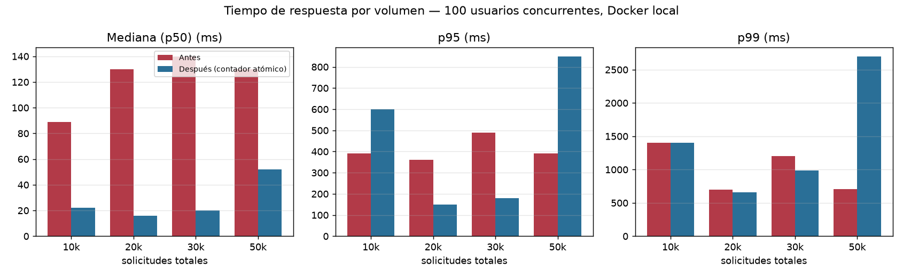
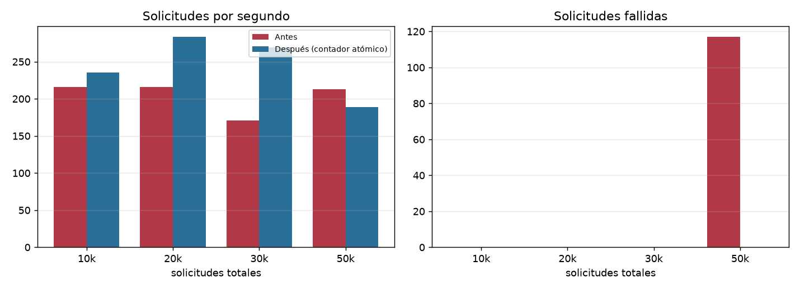
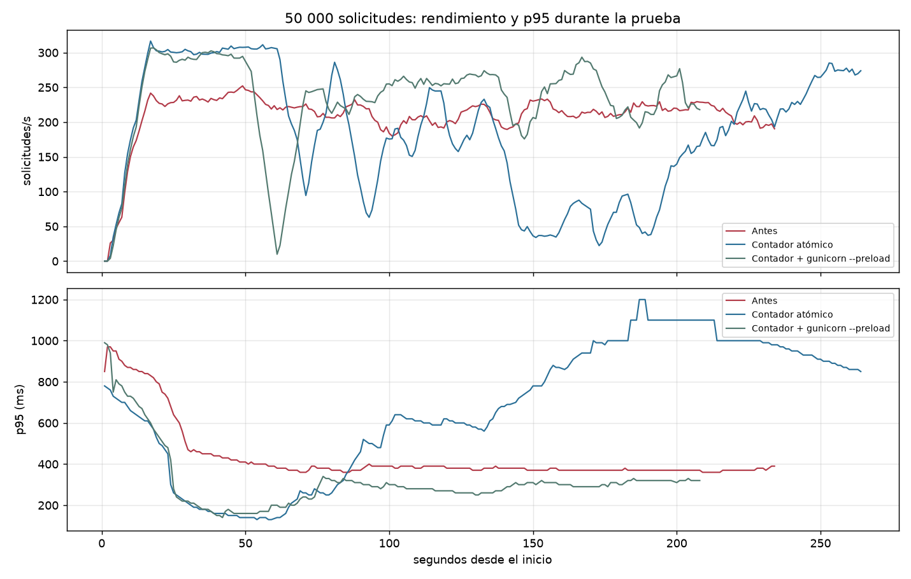
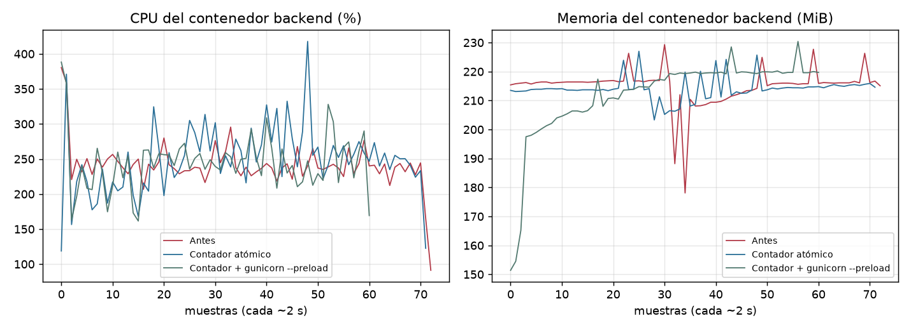
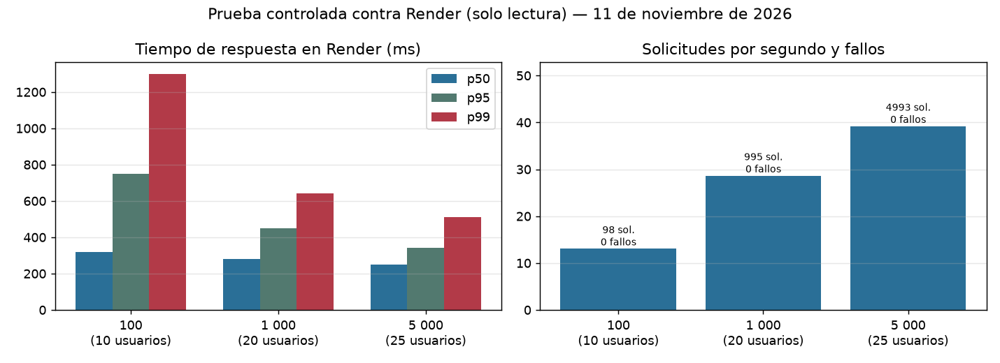

# Pruebas y evidencias

Resultados obtenidos el 13 de octubre de 2026 en el entorno local de Docker Compose (macOS, Docker Desktop 29.7.2). Todos se pueden repetir con los comandos indicados.

## Resumen

| Tipo | Herramienta | Resultado |
|---|---|---|
| Unitarias e integración de la API | pytest + pytest-django, contra PostgreSQL | 144 de 144 correctas (29 de octubre) |
| Unitarias del chatbot | pytest | 36 de 36 correctas (29 de octubre) |
| API de extremo a extremo | Colección Postman ejecutada con Newman | 45 peticiones, 84 aserciones, 0 fallos (29 de octubre) |
| Web de extremo a extremo | Playwright (Chromium) | 10 de 10 correctas (29 de octubre) |
| Estático del frontend | `eslint`, `tsc --noEmit`, `next build` | Sin errores |
| Carga | Locust 2.46.7 | 100 peticiones totales; 50 y 100 usuarios concurrentes: 0 fallos (22 de octubre); 300 usuarios concurrentes: 0 fallos (29 de octubre) |
| Rate limit en vivo | `curl` | 429 con `Retry-After` |
| Carga del 80 % | Locust 2.46.7 | Modalidad A (1000–5000 solicitudes) y B (50–500 usuarios): 0 fallos en los 25 escenarios registrados (sección 10) |
| Resiliencia | `infra/pruebas/resiliencia.sh` | Chatbot, PostgreSQL y backend caídos o congelados: respuestas controladas (sección 11) |
| Respaldo y restauración | `infra/backup/*.sh` | Restauración aislada con conteos idénticos (`BACKUPS.md`) |
| CI (GitHub Actions, 11 de noviembre) | pytest, Node test runner | API 238 correctas; chatbot 43 correctas; unitarias del frontend 10 correctas |
| Carga del 100 % | Locust 2.46.7 | 10 000 a 50 000 solicitudes con 100 usuarios: 0 fallos después de las correcciones (sección 12) |
| Resiliencia del 100 % | `infra/pruebas/resiliencia.sh` | 7 escenarios, 0 fallas (sección 13) |
| Producción en Render | `curl`, solo lectura | Salud, errores, CORS, autenticación y paginación correctos (sección 14) |
| Carga controlada en Render | Locust 2.46.7, solo lectura | 100, 1 000 y 5 000 solicitudes: 0 fallos; p95 de 340-750 ms (sección 16) |
| Código ofuscado | `javascript-obfuscator`, pytest, Playwright | Widget ofuscado: 239 pruebas de API y 5/5 Playwright correctas (sección 17) |

## 1. Pytest

```bash
docker compose run --rm backend pytest
docker compose run --rm chatbot pytest
```

| Archivo (`backend/tests/`) | Qué comprueba |
|---|---|
| `test_auth.py` | Registro y validaciones, hash de contraseña, rol forzado a `cliente`, login, 401 idéntico para correo o contraseña erróneos, perfil, logout que invalida el token |
| `test_faqs.py` | Listado público paginado, filtro por categoría, FAQ inactivas ocultas, CRUD de administrador, 401 y 403 para los demás roles |
| `test_chat.py` | Creación de conversación, mensajes guardados, derivación a asesor, aislamiento entre usuarios, 503 si el chatbot falla, 500 sin detalles internos, historial por rol, `latest` (orden cronológico, 204, nunca conversaciones ajenas para ningún rol) |
| `test_rate_limit_and_errors.py` | Bloqueo 429 en login (10/min), anónimo (60/min) y chat (30/min por usuario), límite por IP, 404 JSON, JSON mal formado, 415 |
| `test_health.py` | 200, 503 por dependencia caída, 405, sin rate limit |

En `test_chat.py` la llamada HTTP al chatbot se sustituye por un doble de prueba. La integración real entre API y chatbot la cubren Newman y Playwright.

## 2. Postman y Newman

Colección: `docs/postman/BlackDogStore.postman_collection.json`. Requiere `seed_demo`.

En Postman: importar la colección, poner en la variable `admin_password` el valor de `DEMO_PASSWORD` de `.env` y ejecutar la colección completa en orden.

Por consola, sin instalar nada:

```bash
set -a; . ./.env; set +a
docker run --rm --network blackdog-chatbot_default \
  -v "$PWD/docs/postman:/etc/newman" postman/newman:alpine \
  run BlackDogStore.postman_collection.json \
  --env-var base_url=http://backend:8000 --env-var admin_password="$DEMO_PASSWORD"
```

Resultado del 13 de octubre: 26 peticiones, 47 aserciones, 0 fallos, respuesta media de 105 ms. Resultado del 19 de octubre, con las peticiones de historial: 28 peticiones, 50 aserciones, 0 fallos.

## 3. Playwright

```bash
cd frontend
npm install
npx playwright install chromium     # solo la primera vez
set -a; . ../.env; set +a        # DEMO_PASSWORD, para la prueba del administrador
npm run test:e2e
```

Usa el stack levantado en `http://localhost:3000` y requiere `seed_demo`. Sin `DEMO_PASSWORD` la prueba del administrador se omite.

| Prueba | Resultado |
|---|---|
| El inicio muestra los tres servicios operativos | Correcta |
| Una ruta inexistente responde 404 con la página propia | Correcta |
| Páginas de mantenimiento y en desarrollo | Correcta |
| El chat y la administración sin sesión redirigen al login | Correcta |
| Registro, chat, recarga con historial, reapertura del navegador, cookie `httpOnly`, cierre de sesión | Correcta |
| El registro rechaza un correo ya usado | Correcta |
| Al volver a iniciar sesión se recupera el historial y la conversación continúa | Correcta |
| Otro usuario no ve el historial; un cliente no entra a FAQ ni a la bandeja; el asesor responde y cierra la consulta derivada; el cliente ve la respuesta y el cierre, y su siguiente mensaje abre otra conversación; el asesor no administra FAQ | Correcta |
| Administrador: validación, crear, editar, desactivar, activar y eliminar una FAQ; el chatbot usa cada cambio; 404 al editar una inexistente | Correcta |

Cada ejecución hace 9 peticiones de autenticación. Dos ejecuciones seguidas en el mismo minuto pueden recibir 429; esperar un minuto.

## 4. Pruebas de carga (Locust)

### Interpretación de "50–100"

El docente no define si "50–100" son peticiones o usuarios concurrentes. Se midieron las dos lecturas:

- **Escenario A:** 100 peticiones HTTP totales, repartidas entre 5 usuarios.
- **Escenarios B y C:** 50 y 100 usuarios concurrentes durante 60 s.

### Configuración común

| Parámetro | Valor |
|---|---|
| Destino | `http://backend:8000`, red interna de Docker Compose |
| Servidor | gunicorn, 4 procesos (antes: `runserver` de Django) |
| Flujo por usuario | Registro y login; después, al azar: FAQ (peso 3), chat (3), perfil (1), health (1) |
| Espera entre peticiones por usuario | 0,1 a 0,5 s |
| Rate limits | Subidos a 100000/min con `docker-compose.loadtest.yml` |
| Equipo | Docker Desktop en macOS, 8 CPU virtuales y 3,8 GiB para la VM de Docker |

Los rate limits se suben porque todas las peticiones salen de una sola IP: con los límites normales se mediría el bloqueo y no el rendimiento. El bloqueo se prueba en la sección 5.

```bash
docker compose -f docker-compose.yml -f docker-compose.loadtest.yml up -d backend
C="docker compose -f docker-compose.yml -f docker-compose.loadtest.yml --profile loadtest run --rm locust"

# A: 100 peticiones totales
$C
# B y C: usuarios concurrentes durante 60 s
TOTAL_REQUESTS=1000000 $C -f locustfile.py --headless --users 50 --spawn-rate 50 --run-time 60s \
  --host http://backend:8000 --csv resultados/concurrentes-50u --html resultados/concurrentes-50u.html --only-summary
#   (lo mismo con 100)

docker compose up -d backend    # restaura los rate limits normales
```

Los contadores del rate limit se guardan en PostgreSQL y sobreviven al reinicio. Esperar un minuto después de la carga antes de lanzar Newman o Playwright; si no, algunas peticiones pueden recibir 429.

### Resultados finales (gunicorn, 22 de octubre de 2026)

| Escenario | Peticiones | Fallos | req/s | Mediana | p95 | p99 | Media |
|---|---|---|---|---|---|---|---|
| A: 100 peticiones totales, 5 usuarios | 100 | 0 (0 %) | 15,9 | 22 ms | 360 ms | 540 ms | 54 ms |
| B: 50 usuarios concurrentes, 60 s | 6048 | 0 (0 %) | 101,1 | 100 ms | 560 ms | 2700 ms | 197 ms |
| C: 100 usuarios concurrentes, 60 s | 3480 | 0 (0 %) | 58,2 | 850 ms | 6200 ms | 8900 ms | 1429 ms |
| D: 300 usuarios concurrentes, 130 s (29 de octubre) | 6407 | 0 (0 %) | 49,4 | 3500 ms | 8800 ms | 9600 ms | 4361 ms |

El escenario D llega a 300 usuarios de 5 en 5 por segundo (`--users 300 --spawn-rate 5 --run-time 130s`). No hay fallos, pero la mediana sube a 3,5 s: con 300 usuarios el equipo local se satura. Al cerrar, Locust muestra `ValueError: I/O operation on closed file` en su escritor de CSV; es un error interno de Locust al terminar y no afecta las peticiones ni los resultados guardados.

Uso de recursos a mitad de prueba (`docker stats`):

| Escenario | Backend | PostgreSQL | Chatbot |
|---|---|---|---|
| B: 50 usuarios | CPU 190 %, RAM 208 MiB | CPU 180 %, RAM 47 MiB | CPU 16 %, RAM 76 MiB |
| C: 100 usuarios | CPU 196 %, RAM 210 MiB | CPU 186 %, RAM 66 MiB | CPU 13 %, RAM 76 MiB |

Evidencias en `loadtest/resultados/`: `carga.html`, `concurrentes-50u.html`, `concurrentes-100u.html` y `concurrentes-300u.html` (gráficos), más sus CSV. Las cifras de la tabla son el resumen final de Locust en consola; los CSV pueden tener unas pocas peticiones menos porque se escriben un instante antes de terminar.

### Antes: servidor de desarrollo `runserver`

| Escenario | Peticiones | Fallos | req/s | Mediana | p95 |
|---|---|---|---|---|---|
| A: 100 peticiones totales | 100 | 0 (0 %) | 9,6 | 39 ms | 1800 ms |
| B: 50 usuarios concurrentes | 3521 | **48 (1,4 %)** | 59,3 | 28 ms | 720 ms |
| C: 100 usuarios concurrentes | 5309 | **122 (2,3 %)** | 88,8 | 37 ms | 610 ms |

Evidencias en `loadtest/resultados/antes-runserver/`.

### Cuello de botella encontrado y corrección

- **Síntoma:** con 50 y 100 usuarios concurrentes fallaban el 48 % y el 61 % de los registros y logins con `ConnectionResetError(104, 'Connection reset by peer')`. Los logins con 401 eran de usuarios cuyo registro había fallado. El resto de endpoints no tenía fallos.
- **Causa:** `runserver` acepta solo 5 conexiones en cola (`socketserver.TCPServer.request_queue_size = 5`, comprobado en el contenedor). Una ráfaga de registros, lentos a propósito por el hash PBKDF2, llena la cola y el sistema reinicia las conexiones nuevas.
- **Corrección:** el backend corre con gunicorn (4 procesos, cola de 2048). Como cada proceso tendría su propia memoria, los contadores del rate limit pasan a una caché compartida en PostgreSQL (`DatabaseCache`).
- **Resultado:** 0 fallos en los tres escenarios. En vivo, 11 logins seguidos dan 10 × 401 y 1 × 429 aunque los atiendan 4 procesos distintos.
- **Por qué el C con `runserver` muestra más req/s:** los usuarios con registro fallido dejaban de enviar peticiones, así que había menos usuarios activos. No era mejor rendimiento.

### Lectura

- **50 usuarios:** sin fallos, unas 100 req/s y mediana de 100 ms.
- **100 usuarios:** sin fallos, pero la latencia sube (mediana 850 ms, p95 6,2 s) y el throughput baja a 58 req/s. El backend y PostgreSQL están cerca de 2 CPU cada uno. Se atribuye a:
  1. El hash de 100 contraseñas a la vez.
  2. La consulta y escritura de los contadores de rate limit en PostgreSQL en cada petición.
- **Pendiente para el 80 %:** medir por separado esas dos causas, probar más procesos de gunicorn y valorar una caché dedicada si el coste en PostgreSQL se confirma.

## 5. Rate limit en vivo

Con los límites normales, 5 logins fallidos después de una ejecución de Playwright (que ya había hecho 5 peticiones de autenticación en el mismo minuto):

```
401 401 401 401 401 429 429 429 429 429 429
HTTP/1.1 429 Too Many Requests
Retry-After: 43
{"error":{"code":"throttled","message":"Solicitud fue regulada (throttled). Se espera que esté disponible en 43 segundos."}}
```

El bloqueo llega en la petición 11 del minuto, como fija `THROTTLE_AUTH=10/min`.

## 6. Corrección: el historial del chat desaparecía al recargar (19 de octubre de 2026)

### Causa

- PostgreSQL sí guardaba conversaciones y mensajes. Comprobado con SQL antes de corregir: la conversación de la prueba manual tenía 4 mensajes.
- El componente `ChatBox` guardaba los mensajes solo en memoria del navegador (`useState([])`), y la página `/chat` no pedía el historial. Al recargar, la lista empezaba vacía y el siguiente mensaje abría una conversación nueva.
- En el backend faltaba un endpoint adecuado: el listado de conversaciones devuelve todas a asesor y administrador, así que no servía para cargar "mi chat".

### Corrección

- Backend: `GET /api/chat/conversations/latest/` devuelve la última conversación del usuario de la sesión, con sus mensajes en orden cronológico; 204 si no tiene.
- Frontend: `/chat` carga ese historial en el servidor antes de mostrar el chat, con el estado "Cargando historial…". Los mensajes nuevos continúan la misma conversación.
- Errores de conexión: si la API no responde, `/chat` muestra un aviso con "Reintentar" y no envía al login. Si falla el envío de un mensaje, el texto escrito se conserva.
- Los 404 ya no muestran nombres internos de modelos.

### Comprobaciones

| Comprobación | Herramienta | Resultado |
|---|---|---|
| Mensajes guardados en PostgreSQL | `psql` | Usuario E2E: 1 conversación, 6 mensajes en orden (`cliente`, `bot`, …) |
| Reaparecen al recargar la página | Playwright | 4 mensajes, mismo texto y orden |
| Cerrar y volver a abrir el navegador | Playwright: nuevo Chromium con las cookies guardadas | 4 mensajes, mismo orden |
| Iniciar sesión otra vez y recuperar el historial | Playwright | 4 mensajes; el siguiente queda en la misma conversación (6 tras recargar) |
| Otro usuario no ve el historial | Playwright | Chat vacío, ningún texto del primer usuario |
| Otro usuario no puede leer ni escribir en la conversación ajena | `curl` a la API | 404 en detalle y en envío; la conversación ajena sigue con 4 mensajes |
| `latest` nunca devuelve conversaciones ajenas | pytest (cliente, asesor, admin) | 204 |
| API caída con sesión activa | `curl` con la cookie de sesión | "No se pudo conectar con el servidor. Tu sesión sigue activa." |
| API restablecida | `curl` | Vuelve a mostrarse el chat |

## 7. Expiración de tokens (21 de octubre de 2026)

Pytest: `backend/tests/test_token_expiration.py`, 13 casos. Token vigente a las 7,9 h; rechazado a las 8,1 h con `token_expired` y borrado; bloqueado en cada ruta protegida; login devuelve `expires_at`; reutiliza el token vigente; reemplaza el caducado; duración configurable.

Comprobación en vivo (usuario ficticio `cliente@example.com`; el token se envejeció 9 h con `UPDATE` en PostgreSQL):

| Paso | Resultado |
|---|---|
| `/chat` con token vigente | Chat visible |
| `/chat` con token caducado | Redirige a `/login?motivo=expirada` |
| Token caducado en PostgreSQL tras usarlo | Borrado (0 filas) |
| `/login?motivo=expirada` | "Tu sesión expiró. Inicia sesión de nuevo." |
| `/login` sin parámetro | Sin aviso |
| Nuevo login | Token distinto; `/api/users/me/` responde 200 |

## 8. Bandeja del asesor (21 de octubre de 2026)

| Herramienta | Qué comprueba | Resultado |
|---|---|---|
| pytest `test_advisor.py` (17 casos) | Filtro por estado y `user_name`; respuesta guardada como `asesor`; el cliente la ve en `latest`; cliente sin permiso para responder o cerrar (403); validación; 404; cierre; 409 en conversación cerrada; el cliente continúa en una nueva | 17 de 17 |
| Newman, carpeta "4b. Bandeja del asesor" (9 peticiones) | Lo mismo contra el stack real | 0 fallos |
| Playwright, prueba 8 | Cliente y asesor en dos navegadores: derivación, respuesta, cierre y nueva conversación | Correcta |

## 9. Pendiente

- Carga contra Render: se autorizó y ejecutó una prueba **controlada y de solo lectura** de 100, 1 000 y
  5 000 solicitudes (sección 16). Las cargas de 10 000 a 50 000 se mantienen en Docker local, para no
  agotar Render Free ni la cuota de Neon.
- En Render, el límite anónimo de 60/min no se aplicó a peticiones directas (sección 16.4): revisar
  `THROTTLE_ANON` y `NUM_PROXIES` en el servicio.
- Con más de 200 usuarios concurrentes escribiendo, el entorno local se satura (sección 10).

## 10. Entrega del 80 %: pruebas de carga con Locust (29 de octubre de 2026)

### Perfiles y modalidades

| Perfil (clase de `loadtest/locustfile.py`) | Qué hace | ¿Escribe en PostgreSQL? |
|---|---|---|
| `Lectura` | Cliente de demostración: health, FAQ, historial propio, última conversación, perfil | No |
| `LecturaAsesor` | Asesor de demostración: bandeja paginada por estado (solo páginas existentes) | No |
| `Escritura` | Usuario nuevo y ficticio: registro, login, chat (continúa su conversación), historial, FAQ, health | Sí |

- **Modalidad A, solicitudes totales:** `TOTAL_REQUESTS=1000|2000|3000|5000` detiene la prueba al enviar esa cantidad, con 50 usuarios. Mide cuánto tarda el sistema en atender un volumen fijo.
- **Modalidad B, usuarios concurrentes:** 50, 100, 200, 300 y 500 usuarios durante 60 s. Si un nivel supera 5 % de fallos o 5 s de mediana, no se ejecutan los niveles superiores de ese perfil.

5000 solicitudes **no equivalen** a 5000 usuarios simultáneos: en la modalidad A, 50 usuarios envían las 5000 solicitudes.

Las cifras de las dos modalidades no se comparan directamente: la A termina al llegar al total de solicitudes y la B mantiene la carga durante 60 s.

```bash
loadtest/campana.sh                     # A y B completas; restaura los rate limits al terminar
TOTAL_REQUESTS=1000 loadtest/ejecutar.sh A-1000req-lectura "Lectura LecturaAsesor" 50 10
python3 loadtest/resumen.py             # resultados/resumen.md y resultados/comparativa.html
```

`ejecutar.sh` cumple tres funciones:

- Espera a que el backend esté `healthy` y responda 3 veces seguidas.
- Registra cada ~3 s la CPU y la memoria de `backend`, `db` y `chatbot`, y las conexiones abiertas en PostgreSQL (`pg_stat_activity`).
- Guarda los resultados con fecha y hora en `loadtest/resultados/AAAAMMDD-HHMMSS_<escenario>*`: HTML, CSV y consola.

Destino: `http://backend:8000`, la red interna de Docker. Nunca Render ni Neon.

| Parámetro | Valor |
|---|---|
| Equipo | macOS con Docker Desktop: 8 CPU virtuales y 3,8 GiB para la VM |
| Backend | gunicorn, 4 procesos `sync`, `CONN_MAX_AGE=60` |
| Datos al empezar | ~9000 conversaciones y ~23 000 mensajes ficticios |

### Optimización medida (100 usuarios, 60 s, 0 fallos en todos los casos)

| Escenario | Solicitudes | req/s | Mediana | p95 | CPU PostgreSQL (media) |
|---|---|---|---|---|---|
| Lectura, **antes** | 3 570 | 59,5 | 1 000 ms | 3 800 ms | 152 % |
| Lectura, **después** | 12 367 | 207,4 | 48 ms | 510 ms | 88 % |
| Lectura, después pero con `CONN_MAX_AGE=0` (aislado) | 2 832 | 47,4 | 1 200 ms | 5 300 ms | 134 % |
| Escritura, **antes** | 4 179 | 69,9 | 770 ms | 3 500 ms | 122 % |
| Escritura, **después** | 7 530 | 125,6 | 220 ms | 1 100 ms | 51 % |


Cambios aplicados entre "antes" y "después":

1. **Reutilizar las conexiones a PostgreSQL** (`CONN_MAX_AGE=60` y `CONN_HEALTH_CHECKS`). Antes, cada petición abría una conexión y PostgreSQL creaba un proceso para atenderla. La prueba aislada, con todos los demás cambios activos y `CONN_MAX_AGE=0`, vuelve a 1200 ms. Este cambio explica casi toda la mejora. En Neon el efecto es mayor, porque cada conexión nueva también negocia SSL.
2. **Índices compuestos** para la bandeja, el historial y los mensajes (`BASE_DE_DATOS.md`). Con 9000 conversaciones, `EXPLAIN ANALYZE` baja de 2,18 a 1,08 ms. El efecto se nota más cuando crecen los datos.
3. **Chatbot con gunicorn** en lugar de `runserver`, como ya tenía el backend.
4. **Detalle de conversación con `prefetch_related`**: una sola consulta para todos los mensajes, verificada con pytest.

### Modalidad A: solicitudes totales (50 usuarios)

| Escenario | Solicitudes | Fallidas | req/s | Media | Mediana | p95 | p99 |
|---|---|---|---|---|---|---|---|
| 1000, lectura | 1 000 | 0 | 94,4 | 165 ms | 30 ms | 1 100 ms | 1 300 ms |
| 1000, escritura | 1 000 | 0 | 60,1 | 468 ms | 70 ms | 2 800 ms | 3 600 ms |
| 2000, lectura | 1 999 | 0 | 105,6 | 139 ms | 34 ms | 590 ms | 1 600 ms |
| 2000, escritura | 2 000 | 0 | 87,2 | 238 ms | 31 ms | 2 000 ms | 2 800 ms |
| 3000, lectura | 3 000 | 0 | 131,7 | 59 ms | 15 ms | 380 ms | 830 ms |
| 3000, escritura | 2 999 | 0 | 99,8 | 178 ms | 28 ms | 1 100 ms | 3 300 ms |
| 5000, lectura | 4 999 | 0 | 137,4 | 50 ms | 19 ms | 180 ms | 740 ms |
| 5000, escritura | 5 000 | 0 | 113,2 | 117 ms | 25 ms | 410 ms | 2 500 ms |

En algunos escenarios la cifra queda una solicitud por debajo del total. La petición restante es la que se reservó cuando Locust ya estaba deteniendo la prueba.

Los percentiles altos de las pruebas cortas vienen del arranque. En escritura, el registro y el login calculan el hash PBKDF2, que es intencionalmente costoso. Con más solicitudes, ese costo inicial pesa menos en el total.

### Modalidad B: usuarios concurrentes (60 s)

| Usuarios | Perfil | Solicitudes | Fallidas | req/s | Mediana | p95 | p99 | CPU backend (media / máx.) |
|---|---|---|---|---|---|---|---|---|
| 50 | Lectura | 8 726 | 0 | 146,6 | 9 ms | 37 ms | 310 ms | 101 % / 261 % |
| 100 | Lectura | 11 332 | 0 | 189,7 | 67 ms | 940 ms | 2 000 ms | 232 % / 388 % |
| 200 | Lectura | 11 418 | 0 | 191,0 | 450 ms | 1 300 ms | 7 400 ms | 253 % / 433 % |
| 300 | Lectura | 9 125 | 0 | 153,2 | 720 ms | 7 900 ms | 19 000 ms | 291 % / 451 % |
| 500 | Lectura | 5 365 | 0 | 89,2 | 1 300 ms | 28 000 ms | 34 000 ms | 350 % / 406 % |
| 50 | Escritura | 8 108 | 0 | 135,6 | 12 ms | 170 ms | 760 ms | 143 % / 373 % |
| 100 | Escritura | 9 583 | 0 | 160,3 | 120 ms | 620 ms | 4 900 ms | 261 % / 414 % |
| 200 | Escritura | 4 904 | 0 | 82,0 | 710 ms | 12 000 ms | 15 000 ms | 328 % / 429 % |
| 300 | Escritura | 2 369 | 0 | 39,6 | 1 100 ms | 23 000 ms | 25 000 ms | 357 % / 429 % |
| 500 | Escritura | 649 | 0 | 10,8 | 26 000 ms | 46 000 ms | 46 000 ms | 401 % / 466 % |

La escritura con 500 usuarios superó los 5 s de mediana y detuvo el escalamiento. No se probaron cargas mayores: el equipo local ya está saturado.

Todas las cifras, incluidas memoria y conexiones, están en `loadtest/resultados/resumen.md`. Los gráficos están en `loadtest/resultados/comparativa.html`.

### Cuellos de botella

1. **CPU del backend con 4 procesos `sync`.** Con 200 usuarios o más, la CPU del backend se acerca al 400 % (4 procesos, uno por núcleo). La de PostgreSQL baja, porque recibe menos trabajo. Las peticiones esperan turno en gunicorn.
2. **Hash de contraseñas.** Cada registro y cada login calcula PBKDF2-SHA256 con 1 000 000 de iteraciones (valor de Django 5.2). Con 500 usuarios nuevos en 10 s, eso son 1000 hashes y la escritura se satura. No se baja el costo, porque protege las contraseñas.
3. **Conexiones a PostgreSQL:** como máximo 6 de las 100 permitidas. No hay presión por conexiones.

### Extra: usar más núcleos del equipo (`GUNICORN_WORKERS`)

Mismos escenarios, con 8 procesos (las 8 CPU de la VM) en lugar de 4. 0 fallos en todos los casos.

| Escenario | Procesos | req/s | Mediana | p95 | RAM backend máx. |
|---|---|---|---|---|---|
| Lectura, 300 usuarios | 4 | 153,2 | 720 ms | 7 900 ms | 231 MiB |
| Lectura, 300 usuarios | **8** | **213,3** | 710 ms | **2 600 ms** | 399 MiB |
| Escritura, 200 usuarios | 4 | 82,0 | 710 ms | 12 000 ms | 231 MiB |
| Escritura, 200 usuarios | **8** | **151,7** | **380 ms** | **5 700 ms** | 412 MiB |

Recomendación:

- **En un equipo local:** `GUNICORN_WORKERS` igual al número de núcleos.
- **En Render Free (512 MB):** 1 proceso, porque la memoria es el límite.

El valor por defecto sigue en 4 y se cambia con la variable.

### Incidencias de la campaña

| Problema | Causa | Evidencia | Solución | Resultado de la nueva prueba |
|---|---|---|---|---|
| 596 respuestas 404 en la bandeja del asesor | La prueba pedía páginas 1 a 5 de estados que tenían menos | Primera ejecución de la línea base, descartada | El perfil consulta `count` y solo pide páginas existentes | 0 errores |
| 20 a 60 `ConnectionRefusedError` al iniciar | `docker compose run locust` recreaba el backend por su `depends_on`, y las peticiones llegaban antes de que gunicorn escuchara | Hora del fallo igual a la de `Listening at` en los logs | `--no-deps` y espera a `healthy` más 3 respuestas seguidas | 0 errores; la prueba aislada sí usa la configuración pedida |
| Dos pruebas duraron 120 y 163 s en lugar de 60 s | La Mac entró en reposo: hay saltos de 58 y 105 s sin datos en el historial | `*_stats_history.csv` (descartados en `resultados/descartados/`) | Se repitieron con `caffeinate -i` | 59 s y saltos de 2 s como máximo |
| Procesos de gunicorn reciclados cada ~50 s con carga | `--max-requests 2000` era bajo para ~40 req/s por proceso | Logs `Worker exiting` / `Booting worker` | `--max-requests 10000` con `jitter 1000` | Reciclaje cada varios minutos, sin fallos |
| `ValueError: I/O operation on closed file` al terminar | Error interno de Locust al cerrar su CSV | Consola de Locust | Ninguna: no afecta a las peticiones ni a los resultados | — |

## 11. Entrega del 80 %: resiliencia (29 de octubre de 2026)

`infra/pruebas/resiliencia.sh` solo actúa sobre Docker Compose local:

- Para, pausa y reinicia contenedores.
- Nunca borra volúmenes.
- Al terminar deja todo en marcha.

Antes y después cuenta las filas de la base: no se perdieron datos (los conteos solo suben por los mensajes de la prueba).

Evidencia: `docs/evidencias/resiliencia_20261029-150817.log`.

| Caso | Resultado esperado | Obtenido |
|---|---|---|
| Chatbot detenido | `/api/health/` 503 con `chatbot=error`; el chat responde 503 `chatbot_unavailable` sin guardar nada | Correcto; conteos iguales antes y después |
| Chatbot congelado (`docker pause`) | El backend corta a los 3 s y responde 503 | 503 en 3,05 s |
| PostgreSQL detenido | Health 503 `database=error`; las rutas responden 500 `server_error` genérico, sin detalles internos; `/chat` muestra "Servicio no disponible" | Correcto |
| PostgreSQL vuelve | El backend se recupera solo, sin reiniciarlo (`CONN_HEALTH_CHECKS`) | 200 |
| Backend detenido | El frontend muestra "Servicio no disponible" con "Reintentar" | Correcto |
| Backend congelado | El frontend corta a los 8 s y muestra "El servidor tardó demasiado" | Correcto, en 8 s |
| Termina el proceso principal del backend | `restart: unless-stopped` lo reinicia | `RestartCount=1`, health 200 |
| `docker compose restart backend` con 20 usuarios | Se espera un corte breve | 5,1 % de fallos en esta ejecución (11,6 % en la primera): conexión rechazada o reiniciada durante unos segundos |
| Recarga en caliente (`docker compose kill -s HUP backend`) con la misma carga | Sin corte | **0 fallos** en 2453 solicitudes |

### Incidencias

| Problema | Causa | Evidencia | Solución | Resultado de la nueva prueba |
|---|---|---|---|---|
| El caso "reinicio automático" daba OK sin reiniciar | La imagen no trae el binario `kill`; el comando fallaba en silencio | `exec: "kill": executable file not found` | `sh -c 'kill 1'` y exigir que cambie `StartedAt` | Reinicio real (`RestartCount=1`) |
| El reinicio completo corta el servicio | Con una sola instancia, el puerto se cierra mientras gunicorn arranca | Paso 6 del log | Para renovar procesos o configuración, usar `HUP`; un cambio de imagen necesita reinicio. El frontend muestra la pantalla de servicio no disponible con "Reintentar" | `HUP`: 0 fallos |
| El selector de idioma volvía al inicio y no cambiaba el idioma en Docker | La redirección usaba la dirección interna del servidor (`0.0.0.0:3000`), no la del navegador | Prueba Playwright del selector | `Location` relativa y comparación del `Referer` con el `Host` | Playwright 10/10 |

## 12. Entrega del 100 %: carga de 10 000 a 50 000 solicitudes (10 de noviembre de 2026)

### 12.1 Dónde se ejecutó y por qué

La campaña se ejecutó contra **Docker Compose local**, no contra Render ni Neon:

- Render Free tiene 512 MB de memoria y un solo proceso de gunicorn. Una carga de 50 000 solicitudes
  mediría el límite del plan gratuito, no el diseño del sistema.
- Neon Free tiene una cuota mensual de cómputo. Agotarla dejaría la demostración pública sin base de datos.
- El propietario del proyecto prohibió expresamente las pruebas de carga contra Render y Neon.

El funcionamiento real en Render se comprobó por separado, con consultas de solo lectura (sección 14), y
con una prueba de carga controlada de hasta 5 000 solicitudes autorizada después (sección 16).

| Elemento | Valor |
|---|---|
| Equipo | Apple M2, 8 núcleos, 8 GiB de RAM, macOS |
| Docker Desktop | 8 CPU y 3,8 GiB asignados |
| Backend | gunicorn, `GUNICORN_WORKERS=4` |
| Base de datos | PostgreSQL 17 en Docker |
| Herramienta | Locust 2.46.7, en un contenedor dentro de la misma red de Docker |
| Destino | `http://backend:8000` (red interna). Nunca Render ni Neon |
| Rate limits | Subidos durante la campaña con `loadtest/limites.sh altos`; restaurados al terminar, siempre |

### 12.2 Qué hace cada usuario simulado

La campaña usa **100 usuarios concurrentes fijos** y aumenta el **volumen total**: 10 000, 20 000,
30 000 y 50 000 solicitudes. Solicitudes acumuladas y usuarios concurrentes no son lo mismo: aquí 100
usuarios envían, entre todos, las 50 000 solicitudes.

| Perfil (`loadtest/locustfile.py`) | Proporción | Qué hace |
|---|---|---|
| `Lectura` | 1/3 | Cliente registrado: inicia sesión y consulta FAQ, su historial y su perfil |
| `LecturaAsesor` | 1/3 | Asesor: recorre la bandeja paginada de conversaciones de su negocio |
| `Widget` | 1/3 | Visitante anónimo del widget: pide la configuración, crea su sesión y conversa (el flujo real de `widget.js`) |

Cada usuario espera entre 0,1 y 0,5 s entre una solicitud y la siguiente.

### 12.3 Cómo repetirla, paso a paso

1. Levantar el entorno local:
   ```bash
   docker compose up -d --build
   docker compose exec backend python manage.py seed_demo
   ```
2. Comprobar que responde: `curl http://127.0.0.1:8000/api/health/` debe devolver `"status":"ok"`.
3. Ejecutar la campaña con una etiqueta (`antes` o `despues`):
   ```bash
   loadtest/campana-100.sh despues
   ```
   El script:
   - evita que macOS se suspenda (`caffeinate -i`), ver la incidencia 12.8-A;
   - sube los rate limits y los restaura al terminar, aunque falle;
   - corre 10 000, 20 000, 30 000 y 50 000 solicitudes, con 15 s de pausa entre corridas;
   - registra CPU, memoria y conexiones de PostgreSQL cada ~2 s (`*_recursos.csv`);
   - al final, envía 5 peticiones a `/api/health/` para comprobar que el sistema se recupera.
4. Los resultados quedan en `loadtest/resultados/` con fecha y etiqueta (`*_stats.csv`,
   `*_stats_history.csv`, `*_failures.csv`, `*_recursos.csv`, `*_consola.txt`).
5. Generar los gráficos (sin instalar nada en el equipo):
   ```bash
   docker run --rm -v "$PWD":/w -w /w python:3.12-slim \
     sh -c "pip install -q matplotlib && python loadtest/graficos_100.py"
   ```
   El script también imprime la tabla de la sección 12.4.

### 12.4 Resultados

Tiempos en milisegundos. «Antes» es el código del 80 %. «Después» incluye el contador atómico de rate
limits y menos consultas por petición (12.6). «Preload» añade `gunicorn --preload` con reciclaje
escalonado.

Fuente: el resumen final de Locust en cada `*_consola.txt`. Es el valor definitivo: `*_stats.csv` se
escribe cada segundo y omite el último, así que sus totales y percentiles difieren levemente.

| Escenario | Solicitudes | Fallos | Solic./s | p50 | p95 | p99 | Máx. |
|---|---:|---:|---:|---:|---:|---:|---:|
| 10 000, antes | 10 000 | 0 | 215,9 | 89 | 390 | 1 400 | 2 427 |
| 20 000, antes | 19 992 | 0 | 216,2 | 130 | 360 | 700 | 1 080 |
| 30 000, antes | 29 993 | 0 | 170,8 | 140 | 490 | 1 200 | 7 692 |
| 50 000, antes | 49 975 | **117 (0,23 %)** | 212,8 | 130 | 390 | 710 | 1 171 |
| 10 000, después | 10 000 | 0 | 235,1 | 22 | 600 | 1 400 | 2 026 |
| 20 000, después | 20 000 | 0 | 283,5 | 16 | 150 | 660 | 1 264 |
| 30 000, después | 29 999 | 0 | 269,5 | 20 | 180 | 990 | 2 764 |
| 50 000, después | 49 995 | 0 | 189,0 | 52 | 850 | 2 700 | 7 801 |
| 50 000, preload (1.ª) | 49 998 | 0 | 239,1 | 49 | 320 | 750 | 9 670 |
| 50 000, preload (2.ª) | 49 981 | 0 | 118,9* | 22 | 230 | 850 | 5 027 |

\* La segunda corrida con preload tuvo una pausa de 232 s sin datos porque el equipo se suspendió
(incidencia 12.8-A). Sin esa pausa, el ritmo fue de unas 265 solicitudes por segundo: es una **estimación**
(49 981 solicitudes en los 188 s con datos), no una medición.

Recursos del contenedor backend con 50 000 solicitudes:

| Corrida | CPU máxima | CPU media | Memoria máxima |
|---|---:|---:|---:|
| Antes | 380 % | 241 % | 229 MiB |
| Después | 418 % | 249 % | 227 MiB |
| Preload (1.ª) | 388 % | 245 % | 230 MiB |
| Preload (2.ª) | 375 % | 223 % | 231 MiB |

El 400 % equivale a 4 núcleos ocupados (4 procesos de gunicorn). La memoria se mantuvo estable en
~230 MiB en todas las corridas: no hay fugas.

Recuperación después de la carga: las 5 peticiones a `/api/health/` respondieron **200 en 4 a 56 ms**,
tanto en la campaña «antes» como en la «después».

### 12.5 Gráficos

| Archivo | Qué muestra |
|---|---|
| `docs/evidencias/graficos-carga-100-percentiles.png` | p50, p95 y p99 por volumen, antes y después |
| `docs/evidencias/graficos-carga-100-rendimiento.png` | Solicitudes por segundo y fallos por volumen |
| `docs/evidencias/graficos-carga-100-50k-tiempo.png` | Las 3 etapas con 50 000 solicitudes, segundo a segundo: rendimiento y p95 |
| `docs/evidencias/graficos-carga-100-recursos.png` | CPU y memoria del backend durante las 3 etapas |






### 12.6 Cuellos de botella encontrados y corrección

Se corrigieron en tres pasos. Cada paso se midió antes de pasar al siguiente.

**Paso 1. El rate limit consultaba demasiado la base de datos.**
- Síntoma: mediana de 89-140 ms con 100 usuarios, aunque las consultas en sí son simples.
- Causa: los rate limits de DRF, guardados en la caché de base de datos, hacían 4 consultas por límite
  en cada petición y guardaban una lista serializada de marcas de tiempo de hasta 37 KB.
- Corrección: un contador atómico propio (`core/throttling.py`, modelo `RateCounter`), con una sola
  consulta `INSERT … ON CONFLICT DO UPDATE` por límite. También se eliminaron dos consultas que se
  repetían: la comprobación del origen del widget y la búsqueda de la membresía del negocio. Las
  consultas por petición bajaron entre un 42 % y un 67 %.
- Resultado: la mediana bajó de 89-140 ms a **16-52 ms** y el ritmo subió hasta 283 solicitudes por
  segundo.

**Paso 2. Pausas de ~45 s al reciclar los procesos de gunicorn.**
- Síntoma: en la corrida de 50 000 «después», el ritmo cae a 25-50 solicitudes por segundo entre los
  segundos 140 y 190, y el p99 sube a 2 700 ms (gráfico `graficos-carga-100-50k-tiempo.png`).
- Causa: gunicorn recicla cada proceso tras un número de peticiones (`--max-requests`). Con un valor bajo
  y parecido para los 4 procesos, se reciclaban casi a la vez, y cada uno volvía a cargar Django desde
  cero.
- Corrección (`backend/Dockerfile`): `--preload` (Django se carga una vez y los
  procesos nuevos se crean copiando el principal) y `--max-requests 20000 --max-requests-jitter 4000`
  (los reciclajes quedan repartidos en el tiempo).
- Resultado: con 50 000 solicitudes, p95 de **320 y 230 ms** y p99 de 750-850 ms, sin pausas largas y
  con la misma memoria (~230 MiB).

**Paso 3. Fallos falsos en el perfil del asesor.**
- Síntoma: 117 errores `404` en `/api/chat/conversations/?status=…&page=…` en la corrida de 50 000
  «antes».
- Causa: el perfil `LecturaAsesor` pedía un número de página calculado al principio. Durante la prueba,
  las conversaciones cambiaban de estado y la página dejaba de existir. DRF responde 404 a una página
  fuera de rango; eso es correcto, el error estaba en el script.
- Corrección: el perfil pide solo páginas que existen en ese momento (`loadtest/locustfile.py`).
- Resultado: **0 fallos** en todas las corridas siguientes.

Cuello de botella conocido que **no** se corrige: el hash de contraseñas (PBKDF2-SHA256 con 1 000 000
de iteraciones) hace lento el login con mucha concurrencia. Se mantiene porque protege las contraseñas
(sección 10).

### 12.7 Lectura de los resultados

- El sistema atendió **50 000 solicitudes con 100 usuarios concurrentes y 0 fallos** después de las
  correcciones.
- La mediana quedó entre 16 y 52 ms; el p95, entre 150 y 320 ms, salvo la corrida previa a `--preload`.
- No hubo errores 5xx, la memoria se mantuvo estable y el sistema se recuperó al instante.
- Estos números son del entorno local con 4 procesos. En Render Free hay 1 proceso y 512 MB, así que el
  rendimiento allí es menor. Por eso la configuración de Render usa 1 proceso y el reciclaje escalonado.

### 12.8 Incidencias de la campaña

| Id | Problema | Causa | Evidencia | Solución | Resultado |
|---|---|---|---|---|---|
| A | Una corrida de 50 000 midió una «pausa» de 232 s | macOS suspendió el equipo por inactividad; Locust contó la pausa como lentitud | Hueco sin datos en `*_C-50000req-preload-2_stats_history.csv` | Los scripts de carga se ejecutan con `caffeinate -i` | Corridas siguientes sin huecos |
| B | 117 errores 404 en la bandeja del asesor | El script pedía páginas que dejaban de existir (12.6, paso 3) | `*_C-50000req-antes_failures.csv` | Perfil corregido | 0 fallos |
| C | Caídas del ritmo a 25-50 solicitudes por segundo | Reciclaje simultáneo de los procesos de gunicorn (12.6, paso 2) | `*_C-50000req-despues_stats_history.csv` | `--preload` y reciclaje escalonado | p95 de 230-320 ms |

## 13. Entrega del 100 %: resiliencia (10 de noviembre de 2026)

Script: `infra/pruebas/resiliencia.sh`. Evidencia: `docs/evidencias/resiliencia_20261110-150446.log`.
Se repitió la prueba de la sección 11 sobre la plataforma multiempresa, con 12 usuarios, 354
conversaciones y 89 503 mensajes en la base. Resultado: **0 fallas**.

| Paso | Qué se simula | Resultado esperado | Resultado |
|---|---|---|---|
| 1 | Servicio del chatbot detenido | `/api/health/` → 503 con `chatbot=error`; el chat → 503 `chatbot_unavailable` sin detalles internos y sin guardar nada; el widget responde con un mensaje de respaldo y deriva a un asesor | Correcto |
| 2 | Chatbot congelado | Corte a los 3 s con 504 `chatbot_timeout` | Correcto (3,02 s) |
| 3 | PostgreSQL detenido | 503 `database_unavailable`; `/chat` muestra «Servicio no disponible»; al volver la base, todo responde sin reiniciar el backend | Correcto |
| 4 | Backend detenido y congelado | El frontend muestra «Servicio no disponible», o «El servidor tardó demasiado» a los 8 s | Correcto |
| 5 | El proceso principal del backend termina | Docker lo reinicia solo (`RestartCount=1`) | Correcto |
| 6 | Reinicio completo del backend con 20 usuarios | Corte breve esperado con una sola instancia | 208 de 2 456 solicitudes fallidas (8,5 %) durante el reinicio: conexión rechazada o reiniciada |
| 7 | Recarga en caliente (`HUP`) con la misma carga | Sin corte | **0 fallos** en 1 600 solicitudes |

Además, el widget reintenta su configuración a los 3, 8 y 15 s cuando el servidor no responde o devuelve
5xx. Con el backend detenido 10 s, el botón del chat apareció solo, sin recargar la página.

## 14. Verificación en Render (11 de noviembre de 2026)

Comprobaciones **de solo lectura** sobre los servicios publicados. No se ejecutó carga contra Render ni
contra Neon.

| Comprobación | Petición | Resultado |
|---|---|---|
| Salud del backend y sus dependencias | `GET https://chatbot-blackdogstore-cloud.onrender.com/api/health/` | 200 `{"status":"ok","checks":{"database":"ok","chatbot":"ok"}}` |
| Ruta inexistente de la API | `GET /api/no-existe/` | 404 `{"error":{"code":"not_found",…}}` |
| Recurso protegido sin sesión | `GET /api/chat/conversations/` | 401 `not_authenticated` |
| Token falso | `GET /api/users/me/` con `Authorization: Token 0000` | 401 «Token inválido.» |
| Login incorrecto | `POST /api/auth/login/` | 401 «Correo o contraseña incorrectos.» |
| CORS con origen no autorizado | `OPTIONS /api/faqs/` con `Origin: https://evil.example` | 403 |
| Paginación | `GET /api/faqs/` | `count: 22` con enlace `next` (20 por página) |
| Página inexistente del frontend | `GET https://blackdog-chatbot-frontend.onrender.com/pagina-que-no-existe` | 404 con la página propia |
| Registro y login | `/registro` y `/login` | 200 |
| Panel sin sesión | `/panel`, `/plataforma` | Solo muestra «Cargando…» y redirige a `/login`; la API no entrega datos sin token |

Funcionamiento con la tienda demo publicada (`https://blackdog-store-demo.onrender.com`):

1. El botón «Asistente» abre el **widget flotante dentro de la tienda**, con el tema oscuro de la tienda.
2. El widget responde las **22 FAQ reales** de Black Dog Store. Se evaluaron 51 preguntas típicas con
   el motor del bot y las FAQ de producción: 48 respondidas por la FAQ correcta. Las 3 restantes nombran
   solo un modelo («iPhone 13», «¿venden ipad?») y ahora las responde el conector de catálogo.
3. «iPhone 13» devuelve los modelos con **precio y stock reales** leídos de la API pública de la tienda.
4. Si el backend de la tienda está dormido (Render Free), el catálogo no responde a tiempo (2,5 s) y la
   consulta pasa a un asesor (incidencia 15-H).

## 15. Incidencias y caídas de la etapa del 100 %

Cada incidencia incluye su causa, la solución aplicada y cómo se comprobó.

| Id | Qué pasó | Causa | Solución | Comprobación |
|---|---|---|---|---|
| A | Tras fusionar el PR #3, Render no desplegó la versión nueva | Los dos servicios de Render seguían configurados con la rama `feat/entrega-80` | Se cambiaron ambos servicios a `main` (Auto-Deploy). Se conservó `feat/entrega-80` como respaldo | Despliegue de `main` correcto |
| B | El código de instalación del widget en producción mostraba `http://localhost:8000` y la vista previa no mostraba el botón | `API_PUBLIC_URL` no estaba definida en el frontend de Render y el código caía en el valor de desarrollo | PR #4: `resolvePublicApiUrl` nunca usa localhost en producción; usa una URL https pública o muestra un aviso. Se añadieron pruebas (`frontend/unit/public-url.test.mjs`) | Botón visible en la vista previa de producción |
| C | El CI del PR #4 falló | Node 22 no acepta una carpeta como argumento de `node --test` | Patrón de archivos entre comillas: `"unit/*.test.mjs"` | CI verde |
| D | La compuerta de SonarCloud del PR #3 falló con 12 hallazgos | Dependencias de CI sin hash, `npm ci` con scripts, un literal SQL, una comparación con `None` y claves de traducción con la palabra «password» | Dependencias con hash (`requirements.ci.lock`), `npm ci --ignore-scripts`, SQL fijo, comprobación explícita y claves renombradas | Quality Gate aprobado |
| E | Un rollback en Render habría devuelto errores 500 | Con `business_id` obligatorio, la versión anterior no podía crear FAQ ni conversaciones (ensayo sobre una copia con 2 337 usuarios y 80 676 mensajes) | Columna anulable en la base (expandir/contraer) y comando idempotente `asignar_negocio_piloto` después de `migrate` | `backend/tests/test_rollback.py` |
| F | Un visitante podía saltarse los límites por IP del widget | El widget llama directo a la API (1 proxy de Render), pero se contaban 2 proxies, así que un `X-Forwarded-For` falso elegía la IP | `WIDGET_NUM_PROXIES` (Render: 1). Sin definir, solo cuenta `REMOTE_ADDR` | `backend/tests/test_widget.py` |
| G | El widget no aparecía si el backend estaba arrancando | En Render Free el backend tarda ~30 s tras dormirse y un despliegue devuelve 502/503 unos segundos | Reintentos de la configuración a los 3, 8 y 15 s ante 5xx o red; nunca ante 403/404 | Backend detenido 10 s: el botón apareció solo |
| H | La tienda demo mostró «No pudimos cargar el catálogo» | Su backend (`blackdog-store-demo-api`) estaba dormido; la primera petición tardó 23 s y la tienda recibió 502 mientras arrancaba | Ninguna en código: abrir los servicios unos minutos antes de una demostración (guía de despliegue). Mantenerlos despiertos con un ping no cabe en las 750 h mensuales del plan Free | Ya despierto: 200 en menos de 0,6 s |
| I | El respaldo de Neon fallaba | `pg_dump` 17 no puede respaldar PostgreSQL 18.6 (Neon) | `infra/backup/respaldar.sh` usa la imagen `postgres:18-alpine` | Respaldo `neon_20261110-171155.dump`, SHA-256 verificado y restaurado en una copia |
| J | Preguntas de precio y de líquidos respondidas con la FAQ de garantía | Palabras clave genéricas («iphone», «celular») en la FAQ de garantía; en un empate gana la primera FAQ | Palabras clave sin nombres de modelos; FAQ de líquidos reforzada | 51 preguntas evaluadas: todas las de FAQ en la respuesta correcta |

## 16. Carga controlada contra Render (11 de noviembre de 2026)

### 16.1 Condiciones autorizadas

El propietario autorizó una prueba **escalonada, pequeña y de solo lectura** contra los servicios
publicados:

- Tres etapas: 100, 1 000 y 5 000 solicitudes totales, con 10, 20 y 25 usuarios concurrentes.
- Solo lectura: nada escribe en la base de datos ni crea conversaciones.
- Detención automática si hay más de 5 errores, o si falla más del 2 % de las respuestas.
- Sin 10 000 a 50 000 contra Render: Render Free (512 MB, 1 proceso) y la cuota de Neon no lo soportan
  sin riesgo de dejar la demostración caída.

Endpoints (todos sin rate limit, para medir el servidor y no el límite de 60 por minuto):

| Endpoint | Peso | Qué ejercita |
|---|---:|---|
| `GET /api/health/live/` | 3 | Proceso de Django, sin dependencias |
| `GET /api/health/` | 2 | Consulta mínima a PostgreSQL (Neon) y al servicio del chatbot |
| `GET /widget.js` | 2 | Archivo que descargan los sitios con el widget |
| `GET /login` del frontend | 1 | Servicio de Next.js en Render |

### 16.2 Cómo repetirla, paso a paso

1. Ejecutar una etapa: `loadtest/render/ejecutar_render.sh <total> <usuarios>`, por ejemplo
   `loadtest/render/ejecutar_render.sh 1000 20`. El script:
   - evita que macOS se suspenda;
   - despierta los servicios (Render Free se duerme) y no empieza si no responden 200, para no medir el
     arranque;
   - corre Locust en un contenedor con `loadtest/render/locustfile_render.py`;
   - termina al llegar al total o al superar el umbral de errores;
   - comprueba la recuperación con 5 peticiones a `/api/health/`.
2. Los resultados quedan en `loadtest/resultados/render/` (CSV y consola; los informes HTML quedan solo
   en el equipo).
3. Generar el gráfico:
   ```bash
   docker run --rm -v "$PWD":/w -w /w python:3.12-slim \
     sh -c "pip install -q matplotlib && python loadtest/render/graficos_render.py"
   ```

### 16.3 Resultados

Resumen final de Locust (`*_consola.txt`); tiempos en milisegundos.

| Etapa | Usuarios | Solicitudes | Fallos | Solic./s | p50 | p95 | p99 | Máx. |
|---|---:|---:|---:|---:|---:|---:|---:|---:|
| 100 | 10 | 98 | 0 | 13,0 | 320 | 750 | 1 300 | 1 303 |
| 1 000 | 20 | 995 | 0 | 28,6 | 280 | 450 | 640 | 859 |
| 5 000 | 25 | 4 993 | 0 | 39,2 | 250 | 340 | 510 | 1 002 |



- **0 fallos y ningún error 5xx** en las tres etapas. Ninguna etapa llegó al umbral de detención.
- La mediana (250-320 ms) es casi toda latencia de red entre el equipo de prueba y Render: el tiempo
  mínimo fue de 128-135 ms.
- El rendimiento creció con la concurrencia (13 → 39 solicitudes por segundo) mientras el p95 **bajó**
  (750 → 340 ms): el servidor no llegó a saturarse con 25 usuarios.
- Recuperación: después de cada etapa, `/api/health/` respondió 200 en 0,2 a 0,4 s.
- La primera etapa tiene un p95 más alto porque los servicios acababan de despertar.
- En la primera ejecución, Locust no terminaba al agotar el total de solicitudes y esperaba el límite de
  20 minutos (94 solicitudes, 0 fallos). Se corrigió deteniendo la prueba desde otro greenlet y se repitió
  la etapa; la tabla muestra la repetición.

### 16.4 Hallazgo: el límite anónimo no se aplica en Render

Prueba aparte, también de solo lectura: 70 peticiones anónimas seguidas a `GET /api/faqs/`
(`loadtest/resultados/render/*_R-rate-limit-faqs.txt`).

| Entorno | Resultado | Esperado (`THROTTLE_ANON=60/min`) |
|---|---|---|
| Docker local | 60 × 200 y 10 × 429 | Correcto |
| Render | **70 × 200, ningún 429** | No aplicado |

El código funciona (lo demuestra el entorno local y `test_rate_limit_and_errors.py`), así que la
diferencia está en la configuración de Render. Causas probables:

1. `THROTTLE_ANON` está definida con un valor más alto en Render. `DESPLIEGUE.md` §4 indica subirla para
   una prueba de carga y restaurarla después.
2. `NUM_PROXIES=2` toma como IP del cliente una dirección intermedia que cambia en cada conexión (por
   ejemplo, la de Cloudflare), y cada petición cuenta como un visitante distinto.

Cómo confirmarlo sin escribir en producción: revisar `THROTTLE_ANON` y `NUM_PROXIES` en *Environment*
del backend en Render, y comparar el campo «Origen» de dos accesos propios en `/admin/auditoria`. Si el
origen cambia entre accesos, la causa es la segunda. **No se modificó producción.**

## 17. Código ofuscado (11 de noviembre de 2026)

Extra del 25 %, «cifrar el código», interpretado como **ofuscar el código que recibe el navegador**: es el
único código del sistema que sale del servidor.

### 17.1 Widget (`widget.js`)

- El código legible se mantiene en `backend/widget/static_src/widget.js`.
- `backend/widget/build/build-widget.mjs` genera `backend/widget/dist/widget.js` con
  `javascript-obfuscator` 5.9.0:
  - nombres internos reemplazados (`_0x…`);
  - el 100 % de los textos codificados en base64 dentro de un arreglo rotado y mezclado;
  - semilla fija, así el resultado es reproducible.
- Se conservan los nombres públicos (`window.BDChatbot`, sus métodos, los eventos `bdchatbot:*` y los
  atributos `data-*`), porque las páginas que instalan el widget los usan.
- No se usan autodefensa ni bloqueo del depurador: rompen sitios de terceros y no protegen nada que el
  servidor no proteja ya.
- En Render el backend corre con Python nativo, sin Node, por eso el archivo generado se versiona. La
  primera línea guarda el SHA-256 del fuente del que salió.

Pasos para regenerarlo después de cambiar el fuente:

```bash
cd backend/widget/build
npm ci --ignore-scripts
npm run build      # escribe dist/widget.js
npm run check      # comprueba que corresponde al fuente
```

### 17.2 Frontend (Next.js)

- El build de producción ya entrega JavaScript minificado y con nombres acortados.
- `next.config.ts` fija `productionBrowserSourceMaps: false`: el navegador no recibe mapas que permitan
  reconstruir el código. Los `.map` que genera Next quedan en `.next/server`, que nunca se publica.

### 17.3 Comprobaciones

| Comprobación | Resultado |
|---|---|
| `test_widget_script_is_served_obfuscated_and_matches_the_source` | `/widget.js` sirve la versión ofuscada, con el SHA-256 del fuente actual y sin nombres legibles |
| Suite completa de la API (pytest, local) | 239 correctas |
| Playwright `saas.spec.ts` con el widget ofuscado | 5/5: se instala una sola vez, responde, deriva al asesor y recibe su respuesta |
| CI: «Widget ofuscado al día» | Falla si `dist/widget.js` no corresponde al fuente |
| CI: «Sin mapas de código fuente publicados» | Falla si `.next/static` contiene un `.map` |
| Frontend local | 0 archivos `.map` en `.next/static`; `/_next/static/chunks/*.js.map` → 404 |
